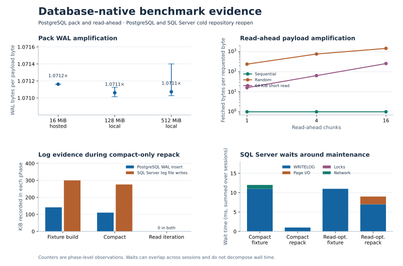
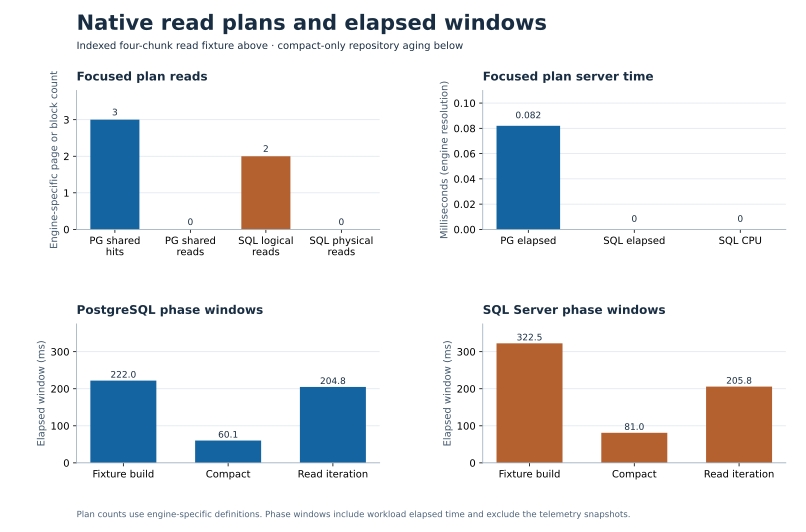

# Database-native benchmark evidence

This record pairs native counters with existing benchmark coordinates. The [normalized CSV](database-native-evidence-2026-11-07.csv) records the observations behind the charts, including the read counters and the reflog and Search comparisons. The [telemetry guide](../operations/database-native-telemetry.md) describes the collection and timing boundaries.

## Charts

### Pack WAL per logical MiB

The PostgreSQL staging runs measured 1.0710–1.0714 MiB of WAL insert-position movement per logical MiB of pack payload. Each plotted point is the median of three observations and the whiskers show their range. The 16-MiB sample came from hosted CI, while the 128- and 512-MiB samples ran in the [local staging experiment](../operations/staging-jdbc-evidence.md). About 7.1% additional WAL relative to the logical payload is a useful budget for these fixtures. Use the ratio as an estimate of log generation, separate from data-file traffic and durable flush latency.

### Read-ahead calls and payload

On PostgreSQL, the 16-chunk sequential scan went from 21 queries to 2 at the same fetched/requested payload ratio of 1. The random workload saved 12 of 30 queries while raising its fetched/requested ratio from about 240 to 1,465. The short read used one query at every setting and went from 16 to 256 times the requested bytes. The measurements support the existing access-pattern-aware policy.

The database-wide PostgreSQL windows recorded 722–761 block hits. Only the one-chunk random sample recorded block reads (39). Treat those deltas as database-cache observations. Publication lag, collector reads and the operating system cache limit attribution to physical storage for these short windows. The client payload and query counters give the direct comparison across windows. See [storage byte metrics](../operations/storage-byte-metrics.md#measured-policy-trade-off).

### Repack and subsequent reads

The plotted coordinate is `reopenAndLookupOldest` after ten pushes with a cold JGit cache. For compact-only maintenance, PostgreSQL recorded 144,976 WAL insert bytes during fixture build and 113,056 during repack. SQL Server recorded 307,200 and 282,624 transaction-log file bytes written during the corresponding phases. Both recorded zero on their respective log counter during the later read iteration. Log generation and log-file writes are distinct measurements, so compare phases within each engine.

The same SQL Server read coordinate recorded 11 ms of `WRITELOG` during fixture build for either repack mode. Compact-only repack recorded 1 ms of `WRITELOG`, while the read-optimized repack recorded 7 ms of `WRITELOG` and 2 ms of page I/O wait. These deltas describe the isolated server over each window. Sessions can overlap and waits are one proxy for elapsed time. The [aging and maintenance evidence](../operations/repack-and-gc.md#resulting-operational-guidance) gives the separate read latency and repack payback across repository ages.

### Read plans and time windows

The focused fixture returned four rows on each engine. PostgreSQL 17.10 used an index scan with three shared-buffer hits, zero shared blocks read and zero WAL bytes. SQL Server 2022 used an index seek with two logical reads, zero physical reads and zero spill warnings. PostgreSQL reported 0.082 ms execution time. SQL Server reported zero for CPU and execution time at the plan's millisecond resolution. The engines define their page counters and time resolution independently. These are two warm indexed reads of a small fixture, separate from the JMH run. [Focused probe scope](../operations/database-native-telemetry.md#focused-pack-chunk-read-diagnostics)

The lower panels show elapsed windows for the earlier cold JGit reopen and compact-only maintenance coordinate. The timestamps bracket each phase and exclude the before/after snapshot calls. They include the work done by the benchmark harness, so use the log counters and waits as separate observations within the corresponding phase.

## Other retained workload boundaries

| Workload | Observation | Interpretation |
|---|---|---|
| Atomic append-only reflog batch | At 50 commands, PostgreSQL WAL insert movement was 30,296 bytes on first application and 96 bytes on replay. SQL Server log-file writes were 57,344 and 0 bytes. | The paired correctness check verified unchanged persisted row counts on replay. Treat the small PostgreSQL residual as a window-level counter. |
| Hibernate Search `content-v1` | Incremental indexing generated 1,032,504 WAL bytes in each of three windows. Rebuild generated 1,078,768–1,078,792. All five measured read methods recorded zero. | Compare the retained indexing and read shapes on the same fixture. The benchmark starts after history and any prebuilt projection are prepared. |

## Source observations

| Workload | Tested revision | Raw evidence |
|---|---|---|
| PostgreSQL pack publication | `a906cf0184ef166e4a8b9774e8dc8f47fbce6211` | [Hosted 16 MiB](https://github.com/carstenartur/jgit-storage-hibernate/actions/runs/42398622879/artifacts/13584920608), [local 128 MiB](staging-jdbc-local-2026-11-07/128-mib/database-telemetry.json), [local 512 MiB](staging-jdbc-local-2026-11-07/512-mib/database-telemetry.json) |
| PostgreSQL read-ahead | `495c5ae2b960b684e4d39335832f1963ac6fca17` | [Nine read-ahead coordinates](https://github.com/carstenartur/jgit-storage-hibernate/actions/runs/42396764354/artifacts/13584020825) |
| Repository aging and repack | `a906cf0184ef166e4a8b9774e8dc8f47fbce6211` | [PostgreSQL](https://github.com/carstenartur/jgit-storage-hibernate/actions/runs/42398622821/artifacts/13584975228), [SQL Server](https://github.com/carstenartur/jgit-storage-hibernate/actions/runs/42398622821/artifacts/13584284059) |
| Atomic reflog batches | `a60fb7fd28c8ec051efb480e5db38b03e9bbaf6a` | [PostgreSQL and SQL Server](https://github.com/carstenartur/jgit-storage-hibernate/actions/runs/32636555092/artifacts/9492479713) |
| Hibernate Search | `62fc007e2fcc5f183cc4d40e1593392912305faa` | [PostgreSQL JMH and native JSON](https://github.com/carstenartur/jgit-storage-hibernate/actions/runs/42397612037/artifacts/13583963275) |
| Focused pack-chunk read plan | `7f4b436ccc163dd50a910d4d36d2ce914e1c0f67` | [PostgreSQL](https://github.com/carstenartur/jgit-storage-hibernate/actions/runs/42406203576/artifacts/13587104194), [SQL Server](https://github.com/carstenartur/jgit-storage-hibernate/actions/runs/42406203576/artifacts/13588065014) |

The CSV retains the selected observations after hosted artifacts expire. The larger repository-aging series and pack-layout benchmark have their own workload and evidence boundaries. Use these charts for the plotted coordinates and repeat a representative workload when sizing a deployment.
