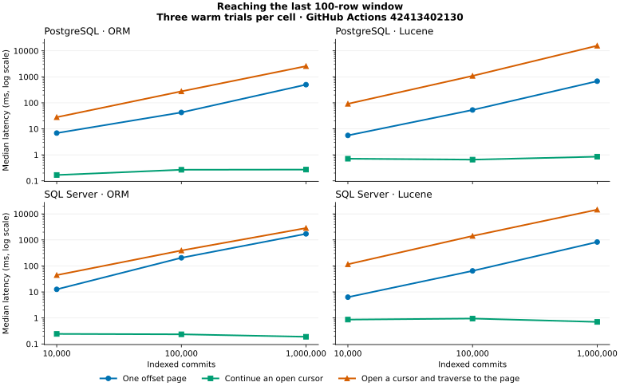
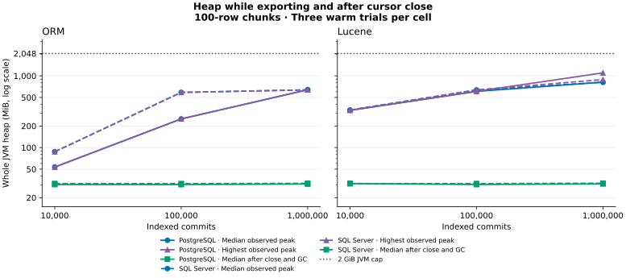

# History scroll and offset evidence

The hosted matrix completed on PostgreSQL 17.10 and SQL Server 2022 CU20
(16.00.4205) at 10,000, 100,000 and 1,000,000 indexed commits. Each of the six
jobs used the production migrations, Hibernate Search 8.4.0.Final, a local
Lucene index, Temurin 21.0.13, and a 2 GiB JVM heap cap. The jobs recorded
444 export runs and checked every row and its order in 2,304 offset pages.
[GitHub Actions run 42413402130](https://github.com/carstenartur/jgit-storage-hibernate/actions/runs/42413402130)

## When to page or scroll

At all 204 sampled positive offsets for the two full export shapes, the median
time for a continuation chunk was lower than the median time for a new offset
page. The earliest sampled continuation was already faster for every database,
fixture size and chunk size. At those same 204 offsets, a single offset page was
faster than opening a new cursor and traversing the preceding results. These
comparisons cover one page at a time and one sequential cursor traversal.

The table gives the deepest sampled window for 100-row chunks. Each cell
shows the median time in milliseconds for a new page, the same chunk on an
open cursor, and the summed API time to open a cursor and reach that chunk.

| Indexed commits | Offset | PostgreSQL ORM | SQL Server ORM | Lucene on PostgreSQL | Lucene on SQL Server |
| ---: | ---: | ---: | ---: | ---: | ---: |
| 10,000 | 9,900 | 6.873 / 0.168 / 27.992 | 12.597 / 0.243 / 44.332 | 5.587 / 0.709 / 91.667 | 6.299 / 0.865 / 115.963 |
| 100,000 | 99,900 | 42.663 / 0.267 / 276.045 | 205.685 / 0.235 / 392.120 | 53.114 / 0.654 / 1,086.165 | 64.590 / 0.948 / 1,419.144 |
| 1,000,000 | 999,900 | 499.258 / 0.271 / 2,566.490 | 1,712.876 / 0.189 / 2,856.878 | 678.901 / 0.850 / 15,702.096 | 831.126 / 0.705 / 14,578.851 |

Use bounded offset pages for random UI navigation and keep the 10,000 guard
unless the deployment has evidence for a different limit. Use an open cursor
when the caller will consume the ordered sequence. At one million rows the
last page cost hundreds of milliseconds to seconds even though the
corresponding continuation took less than a millisecond. The runner compared
deep pages only after lifting the guard on the disposable comparison factory.
It did not benchmark a complete export using repeated deep offset pages.



## Heap and cursor resources

Every million-result export completed with the 2 GiB cap. At 100 rows per
chunk, the largest sampled heap during the three warm full exports was 640
MiB for PostgreSQL ORM, 638 MiB for SQL Server ORM, 1,101 MiB for Lucene on
PostgreSQL, and 888 MiB for Lucene on SQL Server. After close and explicit GC,
the corresponding median used heap was about 31–32 MiB, close to the
pre-export baseline. Across all chunk sizes and filters the largest sampled
heap at one million indexed commits was 1,101 MiB. Heap is a whole-process
sample, so these values include allocation and GC effects and may miss a
short-lived peak.

Each open cursor used one Hibernate session. ORM held one JDBC connection
and finished one Hibernate transaction on close. Lucene held no JDBC
connection and completed no Hibernate transaction. All runs ended with
zero open sessions and zero borrowed JDBC connections. The fixture also
asserts release on first or intermediate early close where those positions
exist, and on interruption.



The result chunks are bounded and the measured jobs stayed within their JVM
budget. Hibernate Search's Lucene scroll can grow its ranked-hit buffer during
traversal, so a post-close GC sample cannot establish a constant heap bound
while the cursor is open. The jobs also leave native statement and wait
telemetry and database or OS cold-start behavior outside the measured scope.
They reopen the Hibernate factory and persisted index before the first-query
trial. The full-size matrix therefore supports the cursor and paging comparison
and its resource-release checks, while the fixed-memory acceptance requirement
for Lucene remains open.

## Choose a chunk size

Keep 100 as the general starting point. Use the filter and path that the
deployment actually exports when tuning. For the one-million-row full export
on these runners:

- **PostgreSQL ORM:** 500 improved median total export time from 2.66 s at
  100 to 2.05 s, while raising the p95 chunk upper bound from 0.30 to 1.08 ms.
  Use 500 when throughput matters more than chunk delivery latency.
- **SQL Server ORM:** total export times at 25, 100 and 500 were all near
  3.0 s. The 25-row chunk lowered the p95 chunk upper bound to 0.09 ms
  from 0.35 ms at 100, while the first chunk still took about 420 ms.
  Keep 100 as the starting point and try 25 if continuation latency dominates.
- **Lucene on either database:** 25 shortened the median first-chunk time
  from 272–284 ms at 100 to 138–148 ms. At 500 the median total export time
  fell from 14.66–15.83 s at 100 to 13.05–14.12 s, with a higher p95 chunk
  upper bound and a slower first chunk. Choose 25 for early delivery and
  try 500 for a full batch export where larger chunks are acceptable.
  Chunk size does not cap the backend's ranked-hit buffer.

Latency and heap figures are observations. Each warm coordinate has three
trials. The hosted CPU model varies between database jobs, and the Lucene path
does not issue SQL, so its timing differences across the database jobs do not
measure a database effect.

## Sources and replay

| Documents | PostgreSQL artifact | SQL Server artifact |
| ---: | --- | --- |
| 10,000 | [13591020235](https://github.com/carstenartur/jgit-storage-hibernate/actions/runs/42413402130/artifacts/13591020235) | [13590741428](https://github.com/carstenartur/jgit-storage-hibernate/actions/runs/42413402130/artifacts/13590741428) |
| 100,000 | [13590342618](https://github.com/carstenartur/jgit-storage-hibernate/actions/runs/42413402130/artifacts/13590342618) | [13590532288](https://github.com/carstenartur/jgit-storage-hibernate/actions/runs/42413402130/artifacts/13590532288) |
| 1,000,000 | [13590108091](https://github.com/carstenartur/jgit-storage-hibernate/actions/runs/42413402130/artifacts/13590108091) | [13591081644](https://github.com/carstenartur/jgit-storage-hibernate/actions/runs/42413402130/artifacts/13591081644) |

The source manifest records the Actions archive SHA-256, size, source commit,
database and JDBC versions, CPU and runner for each cell. The comparison
CSV retains all median offset windows. The export CSV retains each
coordinate's latency, GC, heap and resource summary.
[Source manifest](sources.json) · [Offset comparisons](offset-comparisons.csv) · [Export summary](export-summary.csv)

For each original archive, the verifier checks the digest and configuration
and reproduces the workflow's comparison files byte for byte. Download the
six archives to one directory using the names in the manifest plus `.zip`,
and copy `sources.json` there. From the repository root, run:

```bash
evidence=docs/evidence/history-scroll-2026-11-07
python3 "$evidence/prepare.py" /path/to/downloads \
  .github/scripts/summarize-history-scroll-export.py /tmp/history-scroll-verified
python3 "$evidence/render.py"
```

Chart generation uses Matplotlib 3.10.8. The measured runner source was
`336a65530a16c9a3dd0abfe61b3bed5d5db5b001`.
[Operator guidance and workload definitions](../../operations/search-pagination-and-export.md)
