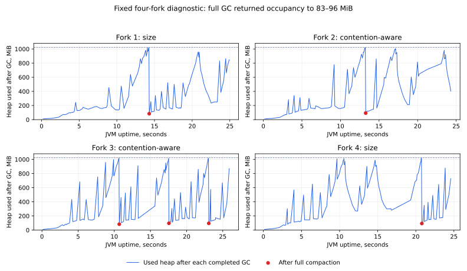

# Publication allocation diagnostic — original JDK 21

**All four predetermined diagnostic forks completed. Both policies exercised
substantial GCLocker/JNI allocation pressure; full collections reduced heap
occupancy from 1,016–1,021 MiB to 83–96 MiB. These JVMs did not have a persistent
near-one-GiB live set. The diagnostic does not reproduce or invalidate the earlier
OOM and supplies no non-regression acceptance result.**

The [original paired study](../publication-paired-2026-11-08/README.md) remains
incomplete in its independent 16-writer/0-ms cell. Its failed fourth pair and
three preceding pairs are unchanged. Issue
[#161](https://github.com/carstenartur/jgit-storage-hibernate/issues/161) remains
open; the production publication selector remains the one-MiB size policy.

## Source and preservation

- [Run 42533525581](https://github.com/carstenartur/jgit-storage-hibernate/actions/runs/42533525581),
  attempt 1; [job 128892750113](https://github.com/carstenartur/jgit-storage-hibernate/actions/runs/42533525581/job/128892750113).
  Contract checks, source comparison, hosted Java compilation/tests, the runner,
  validation, privacy scan and upload passed.
- Measured source: `96f1b08d5d0ca32f98508828c78074f12da688fc`.
- Source tree: `273b30da2c6b007b2e54133091ce403dc2a151d6`.
- Local content-equivalent commit: `1b327b1f2bc12a88f2abfb7bb43cae71e48bf72c`;
  it is not substituted for the actual hosted source.
- [Original archive](archives/publication-gc-diagnostic-original-jdk21.zip):
  artifact `13638597050`, 880,458 bytes, SHA-256
  `fef8a8d07f8044c5d6c52008352cdd7853ba2d106a4f096a904261a3c3dd6046`.
- [Provenance](provenance.json) retains the final run/jobs/artifact API records
  and hashes of 144 files in the [measured source snapshot](sources.tar.gz).

The ZIP contains every JMH result/log and GC/JNI/init log, trial and environment
manifests, the option preflight and original hosted summary. A source guard
compared library sources, relevant POMs, the concurrent workload and profiler
with original source `5ed8aad0f0691bcecb414b319235b67dc0520581`; its Git blob
inventory is retained. No production source, workload setting or dependency
changed for this diagnostic.

## Fixed protocol and observed environment

The [predeclared diagnosis](../publication-paired-2026-11-08/oom-diagnosis.md#smallest-diagnostic-only-next-step)
specified exactly four fresh JVMs: size, contention-aware, contention-aware,
size. All were attempted once, without retry, data-dependent extension, resumed
pair counter or acceptance calculation.

The JVMs used original Temurin HotSpot **21.0.13+9-LTS**, JMH 1.37,
`-Xms256m -Xmx1024m`, 16 writers, independent repositories, PostgreSQL/Hikari,
stateful chunk writing and 256 KiB plus 257 bytes per payload. Each kept two
three-second warmups and three five-second measurements. The only additional
child settings enabled bounded GC/allocation and JNI logs and a separate
collector-initialization log. No heap dump or JFR recording was made.

The runner exposed four logical CPUs on AMD EPYC 9V45; the original failed cell
used AMD EPYC 9V74. PostgreSQL 17.10 used a host-bound ext4 data directory,
`fsync=on`, `synchronous_commit=on`, `full_page_writes=on`, 128 MiB shared
buffers and a one-GiB WAL size target. The unchanged Toxiproxy route added 0 ms;
initial/final `SELECT 1` medians were approximately 0.280/0.205 ms, each from
twenty retained samples after five warmups. These settings do not establish a
hardware power-loss test, cold caches or measured disk bandwidth.

## Observations

Counts cover each entire diagnostic JVM, including setup, warmup and teardown;
they are not restricted to JMH measurement intervals. All four JMH results
selected direct publication only; neither policy selected pre-persistence.

| Fork | Policy | Completed GC events | GCLocker-triggered collections | JNI allocation stalls | Full collections | Heap after full collections |
| --- | --- | ---: | ---: | ---: | ---: | --- |
| 1 | Size | 142 | 75 | 298 | 1 | 84 MiB |
| 2 | Contention-aware | 161 | 105 | 439 | 1 | 93 MiB |
| 3 | Contention-aware | 164 | 93 | 395 | 3 | 83, 96, 95 MiB |
| 4 | Size | 142 | 94 | 383 | 1 | 93 MiB |

There were **zero OOMs and zero GCLocker retry-exhaustion warnings**. G1 recorded
one-MiB regions and a one-GiB maximum heap. Humongous-region counts repeatedly
fell by hundreds. The six full compactions each reclaimed 920–938 MiB; none
left occupancy near the limit. [Full-GC events](derived/full-gc-events.csv)
retain exact uptimes, before/after occupancy, current capacity and pause times.
[All GC events](derived/gc-events.csv) retains 609 completed collections.



Lines connect occupancy observed immediately after completed collections; they
do not interpolate instantaneous usage. Red points identify full compactions.
Post-young-GC peaks and operation-boundary samples can include objects awaiting
later collection and must not be called retained live heap.

Separate JMH measurement-interval allocation estimates were 6.80–7.15 million
bytes/publication, with operation-boundary sampled maxima near the fixed limit.
Logging changes execution and scheduling. These observations inspect a
mechanism; no policy throughput comparison or confidence interval is derived.

## Interpretation and next correction

The earlier OOM exhausted GCLocker retries at approximately one-MiB JGit array
allocations. The exact
[OpenJDK G1 allocation source](https://github.com/openjdk/jdk21u/blob/jdk-21.0.13%2B9/src/hotspot/share/gc/g1/g1CollectedHeap.cpp)
emits that warning on the GCLocker retry-exhaustion path. The matching
[GCLocker implementation](https://github.com/openjdk/jdk21u/blob/jdk-21.0.13%2B9/src/hotspot/share/gc/shared/gcLocker.cpp)
logs stalls and collection following critical-region exit. The new logs observe
hundreds of such stalls under both policies, followed by large reclamations.
This supports allocation pressure interacting with critical regions as a
mechanism. Because the OOM did not recur, the original failed JVM's precise live
heap and the decisive thread occupying a critical region remain unobserved.

The library reports a one-MiB output block size for every extension. Inspected
JGit 7.8 bytecode shows `DfsPackCompactor.configureReftable` replaces the configured
ref block size whenever that output value is positive. Consequently pack
alignment also overrides default four-KiB/configured ref blocks and influences
ref-table compaction thresholds. Two earlier OOM stacks allocated reftable
buffers through this path. A separate semantic correction can preserve reftable
configuration while retaining pack alignment and physical storage chunk sizes.
These diagnostics do not justify changing the selector, increasing heap/retries
or relaxing benchmark budgets.

Any corrected-source counterfactual needs its own source and artifact identity.
Later qualification requires a separately declared protocol and every outcome
retained. Diagnostic successes cannot supply the missing original 24/96-pair
acceptance result.

## Offline replay

```bash
python3 docs/evidence/publication-gc-diagnostic-2026-11-08/reproduce.py \
  --output /tmp/publication-gc-replay
# Optional chart; requires Matplotlib:
python3 docs/evidence/publication-gc-diagnostic-2026-11-08/reproduce.py \
  --output /tmp/publication-gc-replay --plots
```

Replay checks archive digest/length, snapshot blobs, run/source/artifact identity,
safe extraction and privacy. It executes the **measured parser from the snapshot**
and requires a byte-for-byte match with the hosted summary before deriving the
CSVs. No Java workload, network or database access occurs. The
[verification record](derived/verification.json) records the successful replay.
