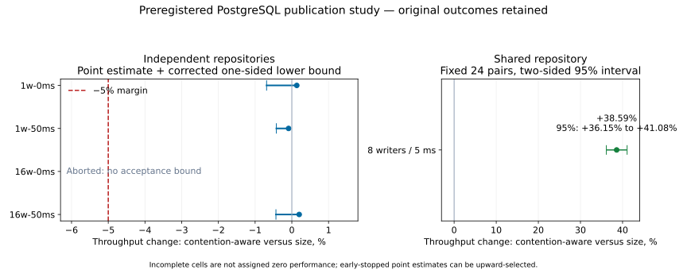

# Preregistered publication-policy study — 2026-11-08

**Three independent-repository cells established the declared non-regression
bound, and the shared-repository cell established a throughput improvement. The
16-writer, 0-ms independent cell aborted with a Java heap allocation failure and
remains incomplete. Issue [#161](https://github.com/carstenartur/jgit-storage-hibernate/issues/161)
therefore remains open; the one-MiB size default is unchanged.**

All five original archives are retained, including the failed fork and its
partial predecessor data. The original study was neither resumed nor rerun to
replace an unfavorable or failed result. A separate diagnostic investigation
cannot supply the missing acceptance result for this study.

## Source, execution and preservation

- [Run 42431132779](https://github.com/carstenartur/jgit-storage-hibernate/actions/runs/42431132779),
  attempt 1, selected by the explicit validation-branch push. The run concluded
  `failure`: four measurement jobs succeeded and one failed. The workflow
  contract passed; unrelated workloads were intentionally skipped.
- Actual measured source: **`5ed8aad0f0691bcecb414b319235b67dc0520581`**.
- Full source tree: **`8a6035b7563d2901bf8d34f62f2c879bc1cb0601`**.
- Local content-equivalent source: `f293b74420fdf23069449d3cdce324d38d1b3338`.
  That commit and this later evidence commit are not substituted for the actual
  measured checkout.

The [provenance record](provenance.json) contains the final API run/jobs/artifacts,
all five archive IDs, original ZIP digests and lengths, and sixteen measured
source blobs. The [source snapshot](sources.tar.gz) contains the exact runner,
benchmark, profiler, statistical parser, relevant production sources, workflow,
POMs and focused tests. The study changes benchmark infrastructure, not the
publication implementation evaluated on the already merged baseline.

Each original ZIP retains protocol/environment records, checkpoint snapshots,
every completed JMH JSON/log pair and all original output from the failed fork.
The four successful ZIPs also retain their hosted summaries and CSVs. Independent
replay verifies **all five ZIP digests and twelve original derived files
byte-for-byte**. No summaries are fabricated for the incomplete cell. Its empty
failed-fork JSON, exception log and missing final environment record remain as
produced by the failed run.

| Cell | Original job | Retained archive |
| --- | --- | --- |
| Independent, 1 writer, 0 ms | [128580085626](https://github.com/carstenartur/jgit-storage-hibernate/actions/runs/42431132779/job/128580085626) | [ZIP](archives/publication-nonregression-independent-1w-0ms.zip) |
| Independent, 1 writer, 50 ms | [128580085639](https://github.com/carstenartur/jgit-storage-hibernate/actions/runs/42431132779/job/128580085639) | [ZIP](archives/publication-nonregression-independent-1w-50ms.zip) |
| Independent, 16 writers, 0 ms | [128580085595](https://github.com/carstenartur/jgit-storage-hibernate/actions/runs/42431132779/job/128580085595) | [Incomplete ZIP](archives/publication-nonregression-independent-16w-0ms.zip) |
| Independent, 16 writers, 50 ms | [128580085660](https://github.com/carstenartur/jgit-storage-hibernate/actions/runs/42431132779/job/128580085660) | [ZIP](archives/publication-nonregression-independent-16w-50ms.zip) |
| Shared, 8 writers, 5 ms | [128580085636](https://github.com/carstenartur/jgit-storage-hibernate/actions/runs/42431132779/job/128580085636) | [ZIP](archives/publication-nonregression-shared-8w-5ms.zip) |

## Workload and decision rule fixed before these scores

Every policy observation uses a fresh JMH JVM, two three-second warmups, three
five-second measurements, JMH 1.37 and Temurin HotSpot 21.0.13+9-LTS. The exact
launch heap is `-Xms256m -Xmx1024m`. The benchmark uses the stateful chunk writer,
PostgreSQL with Hikari, incompressible payloads and complete pack-plus-ref
publication. Independent cells use 256 KiB plus 257 bytes per publication;
the shared cell uses 768 KiB plus 257 bytes. Each invocation creates a distinct
ref; repository metadata grows within the trial. It is not a constant-size
update benchmark or a long-term maintenance test.

Each pair compares `size` with `contention-aware` on the same dedicated runner.
Odd pairs run size first; even pairs run contention-aware first. The statistical
unit is a **fresh-JVM pair**, not one JMH iteration. The statistic is the mean
paired log-throughput ratio, exponentiated to a geometric mean percentage
change. Checkpoint activity is recorded before/after every completed fork and
does not cause an observation to be excluded.

The four independent cells have exactly two possible looks: 24 pairs and, only
if the first lower bound does not exceed −5%, 96 cumulative pairs. The one-sided
lower-bound alpha is `0.05 / (4 cells × 2 looks) = 0.00625`; Student-t critical
values are 2.709720420119227 at 24 pairs and 2.5461530351050503 at 96. The
first-look data must remain in a second-stage result. There is no third look,
extension after an early pass, or selection of the better stage. All three
completed independent cells passed at 24 pairs, so none was extended. Their
early-stopped point estimates can be upward-selected; the corrected lower bound
is the acceptance statistic under the stated log-ratio model.

The shared cell always uses 24 pairs and a two-sided 95% Student-t interval
(critical value 2.0686576104190486). It is a separately declared improvement
test. The protocol does not turn p95/p99 latency, allocation or sampled heap
into powered non-regression claims; those remain inspectable secondary evidence.

The pre-data protocol and review history are retained in the
[specification](../../superpowers/specs/2026-11-07-publication-nonregression.md)
and [implementation plan](../../superpowers/plans/2026-11-07-publication-nonregression.md).

## Results

| Coordinate | Completed pairs | Throughput change | Corrected one-sided lower bound | Original outcome |
| --- | ---: | ---: | ---: | --- |
| Independent, 1 writer, 0 ms | 24 | +0.134% | −0.687% | Non-regression established at the declared look |
| Independent, 1 writer, 50 ms | 24 | −0.089% | −0.421% | Non-regression established at the declared look |
| Independent, 16 writers, 0 ms | 3; fourth pair aborted | Not estimated for acceptance | Not available | Incomplete; heap allocation failure |
| Independent, 16 writers, 50 ms | 24 | +0.201% | −0.433% | Non-regression established at the declared look |

The shared 8-writer/5-ms cell showed **+38.594% throughput**, with a **two-sided
95% interval of +36.151% to +41.082%**, from 24 pairs. This is a statistically
credible benefit in the declared contended workload. It does not complete the
missing independent-cell acceptance condition or justify changing a global
default.



The graph deliberately gives the failed cell no point or interval. The three
independent lower bounds and the shared two-sided interval have different
interpretations. [Outcome CSV](derived/outcomes.csv) retains unrounded values;
the copied per-cell summaries and `pairs.csv`/`secondary.csv` remain beside it.

### What the path and secondary counters show

All completed independent-cell observations selected direct publication only.
The shared contention-aware observations selected approximately one
pre-persisted pack per publication, while the size policy remained direct. The
extra transaction is visible rather than hidden in the throughput result.

For the shared cell, the following are **medians across the 24 per-fork
aggregates** for each policy. A median of per-fork p95 values is not a pooled
operation percentile or an additional confidence interval. The final heap row
instead takes the maximum of all 24 per-fork sampled maxima.

| Shared-cell observation | Size policy | Contention-aware |
| --- | ---: | ---: |
| Throughput, publications/s | 13.899 | 19.307 |
| Storage transactions per publication | 2.262 | 3.244 |
| Pre-persisted selections per publication | 0 | 1.000 |
| Per-fork p95 pack/ref duration, ms | 619.708 | 475.097 |
| Per-fork p95 pack-lock acquisition, ms | 244.004 | 182.904 |
| JMH allocation, bytes/publication | 10,460,012 | 11,120,426 |
| Maximum sampled heap used over all forks, MiB | 374.063 | 384.479 |

Lock wait and complete publication tails decreased in these descriptive
observations, while allocation and transaction cost increased. Heap samples are
`totalMemory - freeMemory` after successful operations; they include objects
awaiting collection and do not measure retained live memory or an instantaneous
peak. The raw results retain all per-iteration counters and percentile data.

## Actual database and host conditions

Every cell recorded PostgreSQL 17.10 with `fsync=on`, `synchronous_commit=on`
and `full_page_writes=on`, a host-bound ext4 database directory, 128 MiB
`shared_buffers`, 1 GiB `max_wal_size` and 100 maximum connections. These are
observed engine settings, not a hardware power-loss test. The initial/final RTT
calibrations each use twenty retained `SELECT 1` samples after five warmups.

| Coordinate | Host CPU model; all expose 4 logical CPUs | Initial median RTT, ms | Final median RTT, ms |
| --- | --- | ---: | ---: |
| Independent, 1 writer, 0 ms | Intel Xeon Platinum 8370C | 0.439 | 0.342 |
| Independent, 1 writer, 50 ms | AMD EPYC 9V45 | 50.583 | 50.544 |
| Independent, 16 writers, 0 ms | AMD EPYC 9V74 | 0.363 | Missing because of abort |
| Independent, 16 writers, 50 ms | AMD EPYC 7763 | 50.973 | 51.211 |
| Shared, 8 writers, 5 ms | AMD EPYC 9V74 | 5.612 | 5.539 |

Between-cell differences are not attributed solely to writer count or RTT:
the cells used different hosts. Each policy contrast stays within its paired
cell. A filesystem-backed database and freshly staged data do not establish
cold OS/database caches, native wait attribution or disk bandwidth. No cache
flush, process-level memory cap beyond the Java heap, or physical-I/O lower
bound is claimed.

## Incomplete cell and separate diagnosis

The failed 16-writer/0-ms cell completed three pairs. In pair four, the
contention-aware fork failed during measurement iteration two with
`OutOfMemoryError: Java heap space`. Three preceding warnings report GCLocker
allocation-retry exhaustion for 131,074 machine words. The failed allocations
occur in JGit reftable and pack-buffer construction; the repository's aligned
stream gives them one-MiB buffers.

All six completed forks in that cell selected direct publication. Both policies
sampled heap usage near the one-GiB maximum. That establishes a common pressure
condition; it does not establish a policy-specific regression, a retained-memory
leak, or a harmless JVM false alarm. The strict measured validator rejects this
cell because it lacks final environment/RTT completion, and no acceptance
interval is calculated from its three surviving pairs.

The [read-only diagnosis](oom-diagnosis.md) relates the observed warning to the
exact OpenJDK 21.0.13+9 G1 and JNI source and records the alternative explanations.
It proposes four separate diagnostic JVMs with unchanged load, heap and policy
code and added GC/JNI logs. Their source and results, when available, have their
own provenance. They must not resume, replace or qualify this failed study.

Those [four original-runtime diagnostics](../publication-gc-diagnostic-2026-11-08/README.md)
subsequently completed without OOM. Both policies exhibited JNI allocation
stalls, and full collections returned occupancy to 83–96 MiB. These separate
observations help distinguish allocation pressure from sustained retained heap;
they do not change this study's incomplete-cell outcome or acceptance bounds.

## Acceptance and remaining scope

The already merged selector remains opt-in, has bounded striped state and the
deterministic fallback, and retains the existing atomicity, replacement,
rollback and lease semantics. This follow-up adds a credible contended gain and
three powered, bounded independent comparisons on the observed storage setup.
It **does not satisfy all four declared independent-cell checks**.

Keep #161 open while the allocation failure is diagnosed and any justified
correction is independently verified. A subsequent qualification would need a
separate declared source/protocol and all its outcomes retained. There is no
automatic repeat-until-pass path. Larger payloads, the internal connection pool,
other writer/RTT combinations and long-horizon repository growth remain
unqualified by this particular study; neither all-matrix coverage nor a global
default promotion is implied.

## Offline reproduction

From the repository root:

```bash
python3 docs/evidence/publication-paired-2026-11-08/reproduce.py \
  --output /tmp/publication-paired-replay
# Optional figure; requires Matplotlib:
python3 docs/evidence/publication-paired-2026-11-08/reproduce.py \
  --output /tmp/publication-paired-replay --plots
```

The wrapper requires the final original run and all five unique cells, checks
archive/source identities and safe extraction, scans the original raw data for
connection details, and uses the **measured parser** from the retained source
snapshot. Four completed cells must reproduce their original JSON and CSV bytes;
failed jobs must remain rejected as incomplete. The wrapper then writes the
qualified outcome table, preserved per-cell results and verification record.
After that byte comparison, readable CSV copies use LF line endings; the
original CRLF bytes remain unchanged in the ZIPs. Values are not rounded or edited.
It does not execute Maven/JMH, access a database or fetch new data.
