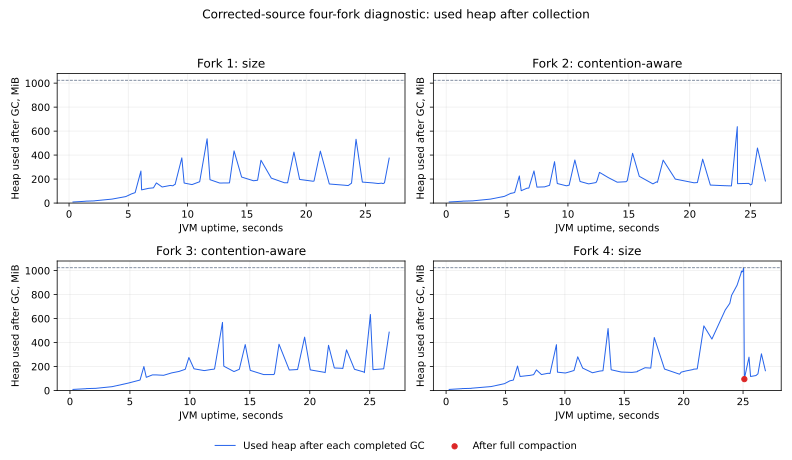

# Reftable allocation counterfactual — 2026-11-08

**The candidate source completed all four fixed diagnostic forks and reported
4.37–4.49 million allocated bytes per publication, compared with 6.80–7.15 million
in the original-source diagnostic. Allocation pressure remains: the final size
fork reached 1,022 MiB after a collection and required full compaction. These
diagnostics do not establish that OOM is eliminated, independent non-regression,
or a benefit from the adaptive policy.**

The candidate changes the physical alignment hint that JGit uses for logical
reftable blocks. Real JGit tests verify the proposed configured/default layout
and reference integrity; they do not prove that the previous hint violated
JGit's contract. Pack and all other extension alignment stay at one MiB. The
production selector default and the original failed study are unchanged.

**Integration decision, 2026-11-09:** retain the existing production alignment.
The candidate and its layout tests remain in the immutable experimental source
and source archive. A controlled insert-throughput comparison can address the
cross-host uncertainty, but cannot by itself qualify the changed compaction
threshold or growing-stack read behavior.

## Execution and immutable evidence

- [Run 42535450496](https://github.com/carstenartur/jgit-storage-hibernate/actions/runs/42535450496),
  attempt 1, completed successfully on the exact predeclared validation branch.
- [Diagnostic job 128898681627](https://github.com/carstenartur/jgit-storage-hibernate/actions/runs/42535450496/job/128898681627)
  passed the source guard, Maven build, sequence/pairing tests, real JGit reftable
  tests, all four attempts, strict artifact validation and privacy scan.
- Actual measured commit: **`fcd8eb6ba5fa009f50c20f927fe6e932aca6510b`**.
- Actual source tree: **`a349eaed773a8708550dba313718073ff82aeb8e`**.
- Content-equivalent local source: `83c10213ebe12c8df15a5fe967d190f557e96c77`.
  This evidence commit is not substituted for the measured checkout.
- Original [artifact 13639605477](https://github.com/carstenartur/jgit-storage-hibernate/actions/runs/42535450496/artifacts/13639605477):
  325,269 bytes; SHA-256
  **`95cd07744a4194c1751ae826cfa3f4e8a728e28e5e3609668612dd87795d141f`**.

The [original ZIP](archives/publication-gc-diagnostic-reftable-jdk21.zip) retains
every raw JMH JSON/log, GC/JNI/init log, protocol, environment, trial, outcome,
source inventory and hosted summary. The [provenance record](provenance.json)
retains the final run/jobs/artifact API records, original archive length/digest,
and all 150 measured source blob/digest entries. The [source snapshot](sources.tar.gz)
contains the exact measured parser, workflow, runners, production sources,
dependency POMs, source guard, tests and predeclared counterfactual plan.

## The single measured library change

**Contract clarification after this run:**
[JGit's `DfsOutputStream` contract](https://github.com/eclipse-jgit/jgit/blob/v7.8.0.202609011348-r/org.eclipse.jgit/src/org/eclipse/jgit/internal/storage/dfs/DfsOutputStream.java)
defines block size as a recommendation and explicitly permits sizes in the
one-to-four-MiB range. Omitting a recommendation is also permitted.
[Its reftable adapter](https://github.com/eclipse-jgit/jgit/blob/v7.8.0.202609011348-r/org.eclipse.jgit/src/org/eclipse/jgit/internal/storage/dfs/DfsPackCompactor.java)
intentionally applies a positive hint. The earlier description of this proposal
as an independently justified correctness defect was too strong. The change is
an allocation/layout optimization candidate requiring a controlled performance
check. Original source snapshots and their pre-data wording remain immutable.

The native source guard compared all core production source, three dependency
POMs, `ConcurrentPublicationBenchmark` and `PackPublicationProfiler` with original
study source `5ed8aad0f0691bcecb414b319235b67dc0520581`. It permitted only
`ReadAheadHibernateObjDatabase.java`, exact Git blob
`69da64f8bb579d409ed975e338a35b40cf861f3b`. It also rejected uncommitted or untracked
measured source. Offline replay verifies that same single difference against the
retained original diagnostic's source blobs.

JGit's actual `DfsPackCompactor.configureReftable` replaces a reftable's ref-block
size and alignment when its output stream reports a positive physical block
size. The production storage implementation returns the one-MiB pack hint for
REFTABLE as well. The candidate returns the ordinary staged stream for that
extension, allowing JGit to keep its configured logical block layout. It does
not change the persisted chunk layout, read channels, publication algorithm,
policy state, transaction semantics, heap budget or other extension output.
The [reftable commit code](https://github.com/eclipse-jgit/jgit/blob/v7.8.0.202609011348-r/org.eclipse.jgit/src/org/eclipse/jgit/internal/storage/dfs/DfsReftableBatchRefUpdate.java)
also uses three times the effective ref-block size as its top-table compaction
limit. The candidate therefore changes that limit from three MiB to twelve KiB
under the default configuration. This can affect stack growth and read/update
work; allocation savings alone do not settle that tradeoff.

Four [experimental layout tests](https://github.com/carstenartur/jgit-storage-hibernate/blob/fcd8eb6ba5fa009f50c20f927fe6e932aca6510b/jgit-storage-hibernate-core/src/test/java/io/github/carstenartur/jgit/storage/hibernate/objects/ReftableOutputAlignmentTest.java)
use production `writeFile`, JGit's actual adapter,
`ReftableWriter` and `ReftableReader`. They cover the 4,096-byte default, an
explicit aligned 8,192-byte configuration, an explicit unaligned configuration,
all 512 exact references per table, staging cleanup and all other extensions'
one-MiB alignment/positional reads. The three reftable cases failed against the
original implementation; all four pass with the candidate. This establishes
the proposed layout and reference integrity, not a defect in the original.

## Protocol fixed before execution

The [predeclared plan](../../superpowers/plans/2026-11-08-publication-reftable-counterfactual.md)
retains the original diagnostic's PostgreSQL/Hikari, stateful writer,
independent repositories, 16 writers, 256 KiB plus 257 bytes, zero added RTT,
two three-second warmups, three five-second measurements and fresh JVM per
attempt. The order remains size, contention-aware, contention-aware, size.
There are no replacement forks, retries or data-dependent extensions.

Temurin HotSpot **21.0.13+9-LTS**, `-Xms256m -Xmx1024m` and the exact bounded
GC/JNI logging options are unchanged. The separate parent-only `reftable`
variant records provenance without changing child JVM arguments or benchmark
work. The pre-launch cancellation correction prevents an unstarted fork from
acquiring an invented outcome; it does not change a successful sequence.

The database was PostgreSQL 17.10 on a host-bound ext4 directory, with
`fsync=on`, `synchronous_commit=on`, `full_page_writes=on`, 128 MiB shared buffers
and a 1 GiB WAL size setting. Initial/final `SELECT 1` RTT medians were
**0.484/0.436 ms**. The host exposed four CPUs from an **AMD EPYC 7763**.
These settings describe the observed fixture; they do not establish physical
storage durability or cold caches.

## Observations

All four forks completed without an OOM or GCLocker allocation-retry-exhaustion
warning. Every observed policy selection remained direct; neither policy used
pre-persistence in this independent-repository coordinate.

| Fork | Policy | Allocation, million B/publication | Completed GC events | GCLocker collections | JNI allocation stalls | Full collections | Maximum heap after completed GC, MiB |
| --- | --- | ---: | ---: | ---: | ---: | ---: | ---: |
| 1 | Size | 4.476 | 59 | 30 | 121 | 0 | 536 |
| 2 | Contention-aware | 4.431 | 64 | 31 | 93 | 0 | 637 |
| 3 | Contention-aware | 4.373 | 61 | 29 | 104 | 0 | 634 |
| 4 | Size | 4.490 | 87 | 35 | 133 | 1 | 1,022 |

The one full collection in fork four reduced occupancy from **1,022 to 95 MiB**
and lasted 59.966 ms. The maximum operation-time heap sample in that fork was
1,023.3 MiB. A heap sample includes objects awaiting collection; it does not
measure retained live memory or guarantee that an allocation can succeed.



[GC events](derived/gc-events.csv), the [full collection](derived/full-gc-events.csv),
and [all eight original/candidate fork observations](derived/fork-observations.csv)
retain unrounded values. GC/JNI log counts cover the complete JVM, including
setup, warmup and teardown. Allocation, throughput and operation-time heap
samples come from JMH measurement intervals. They are different observation
windows and must not be divided into each other as if they measured the same
operations.

### Comparison with the original diagnostic

| Descriptive observation | Original source | Corrected source |
| --- | ---: | ---: |
| Completed forks | 4 | 4 |
| Allocation, million B/publication, range | 6.797–7.152 | 4.373–4.490 |
| Throughput, publications/second, range | 134.174–152.450 | 95.075–102.544 |
| Whole-JVM completed GC events, total | 609 | 271 |
| Whole-JVM GCLocker collections, total | 367 | 125 |
| Whole-JVM JNI allocation stalls, total | 1,515 | 451 |
| Full collections, total | 6 | 1 |
| CPU model; four exposed CPUs in both runs | AMD EPYC 9V45 | AMD EPYC 7763 |
| Initial/final median RTT, ms | 0.280/0.205 | 0.484/0.436 |

The allocation observations are consistent with removing the large
reftable buffer. They are not a controlled estimate of its effect: the runs
used different hosts and observed different throughput, RTT and publication
counts. Each publication adds a distinct ref, so metadata growth also differs
with completed work. The lower absolute throughput is retained explicitly; it
cannot be assigned to the candidate or dismissed as harmless from these two
runs. A throughput or allocation comparison across candidate and original
source would require its own controlled design.

Fewer collection/stall events do not prove that the allocation failure is
eliminated. Both original and candidate four-fork diagnostics completed, and
the candidate size fork still approached the fixed heap ceiling. The original
failed JVM's exact live-heap ownership remains unavailable. Both policies used
the direct path, so these observations do not establish an adaptive-policy
benefit or penalty.

## Qualification status and next decision

The [original five-cell study](../publication-paired-2026-11-08/README.md) remains
incomplete, including its original failed fourth pair. No fork here is used to
fill that gap, and no statistical acceptance interval is derived from either
four-fork diagnostic. The default remains the deterministic one-MiB size rule.

The lower absolute throughput requires a controlled baseline/candidate
comparison on one host. Production retains its existing alignment until the
write, compaction and read tradeoffs are qualified. A later
current-source policy qualification would instead compare size with
contention-aware policy on the chosen implementation; it cannot resolve the
implementation's before/after tradeoff. It would require all five cells and the
original 24/96-pair stopping rule, with every outcome retained. The remaining
representative payload/provider coverage in #161 also needs an explicit scope;
these diagnostics do not complete it.

## Offline replay

From the repository root:

```bash
python3 docs/evidence/publication-reftable-diagnostic-2026-11-08/reproduce.py \
  --output /tmp/publication-reftable-replay
# Optional figure; requires Matplotlib:
python3 docs/evidence/publication-reftable-diagnostic-2026-11-08/reproduce.py \
  --output /tmp/publication-reftable-replay --plots
```

Replay checks the exact run/artifact/source identities, archive lengths and
digests, safe extraction, all source blobs and the privacy scan. It executes
the **measured parser from the source snapshot** and requires byte-identical
reproduction of the hosted summary. It independently replays the preceding
original diagnostic, checks the permitted source difference and derives the
eight-fork observation CSV. No Maven/JMH, database or network access is used.
