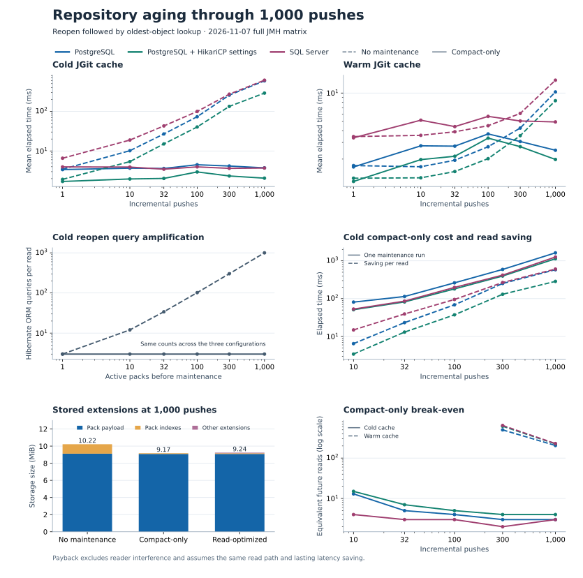

# Full repository-aging matrix with SQL Server

The 2026-11-07 run completes the 1–1,000-push age axis for SQL Server and repeats the same
axis for both PostgreSQL configurations and HSQLDB. It supports a manual maintenance decision
based on measured read degradation, cache state, and payback.

## Provenance and coverage

| Evidence | Value |
|---|---|
| Source | [Protected `main` commit `f8a4e91`](https://github.com/carstenartur/jgit-storage-hibernate/commit/f8a4e91a0c043eadf0c0ac46bb42a39b00e2c032) |
| Workflow | [Full run `42384374593`](https://github.com/carstenartur/jgit-storage-hibernate/actions/runs/42384374593) |
| Raw JMH JSON, shard manifest, and conversion | [Merged artifact `13579707759`](https://github.com/carstenartur/jgit-storage-hibernate/actions/runs/42384374593/artifacts/13579707759) |
| Verified archive SHA-256 | `ed73f8926708c8666af3dc4d7389d5a7c5bc7c1007361fbccbc68113aa69416e` |
| Durable results | [CSV with all 1,152 coordinates](repository-aging-full-2026-11-07.csv) |

All eight backend/cache shards and their aggregate passed. Each shard contains six push counts
(1, 10, 32, 100, 300 and 1,000), three maintenance modes (none, compact-only and read-optimized),
and eight operations. JMH 1.37 ran on JDK 21.0.13 with one thread and one fork per coordinate,
one 500 ms warmup iteration, and three 750 ms sample-time measurement iterations. Each coordinate
uses the same Hibernate provider for setup and measurement. Cold refers to JGit's block cache.
Operating-system and database caches can already be warm. The three timed iterations represent
one independently constructed trial at each coordinate.

The PostgreSQL rows preserve the `postgresql` and `postgresql-hikari` benchmark configurations.
The latter sets explicit HikariCP options. The raw results do not record the effective connection
provider class, so the two labels support a comparison of configurations.

The CSV preserves the converter's normalized latencies, p50/p95/p99, storage counters,
maintenance duration, and payback. Its last two columns are the means of the last invocation's
query-count and database-payload observations across measurement iterations. Hibernate's query
counter measures ORM executions. The payload counter measures extension bytes read by the storage
path. Network traffic, database pages, and WAL or transaction-log bytes are separate measurements.

Reproduce the normalization after extracting the aggregate artifact.

```sh
python3 .github/scripts/convert-jmh-repository-aging.py --full-matrix \
  /path/to/extracted/jmh-result.json /tmp/repository-aging-normalized
```

## Charts



## Latency and query amplification

The table gives mean elapsed time in milliseconds for reopen followed by oldest-object lookup on
SQL Server. In both PostgreSQL configurations, this run reproduces the direction seen in the
[September full matrix](repository-aging-full-2026-09-04.md). Compact-only improves cold reopen
from 10 pushes onward. Warm reopen regresses at 10, 32, and 100 pushes and improves at 300 and
1,000. SQL Server has the same direction at these measured ages.

| Pushes | Cold without maintenance | Cold compact-only | Warm without maintenance | Warm compact-only |
|---:|---:|---:|---:|---:|
| 1 | 6.553 | 3.959 | 3.461 | 3.361 |
| 10 | 18.812 | 3.922 | 3.568 | 5.160 |
| 32 | 42.775 | 3.465 | 3.892 | 4.414 |
| 100 | 99.080 | 3.961 | 4.508 | 5.660 |
| 300 | 270.882 | 3.637 | 6.085 | 5.061 |
| 1,000 | 609.310 | 3.706 | 13.661 | 4.945 |

At 1,000 pushes, SQL Server p95 for the cold path falls from 695.206 to 5.130 ms. In all three
database/pool configurations, cold reopen at that age executes 1,002 Hibernate queries before
compaction and 3 afterward. The cold lookup touches many individual pack indexes without
compaction. A compacted index can require more bytes in one read at smaller ages. At 100 pushes on
SQL Server, the last-invocation payload observation grows from 133,020 to 877,168 bytes even as
mean latency falls. At 1,000 pushes it falls from 1,175,940 to 373,826 bytes.

## Maintenance cost and payback

At 1,000 pushes the compact-only cost, mean time saved per reopen and whole-read break-even differ
substantially by cache state. The division uses the matching no-maintenance trial for each
backend and cache state. It prices the maintenance action and assumes the measured read saving
persists for future reads of the same kind.

| Backend | Cold cost | Cold saving per read | Cold reads | Warm cost | Warm saving per read | Warm reads |
|---|---:|---:|---:|---:|---:|---:|
| PostgreSQL | 1,629 ms | 583.194 ms | 3 | 1,594 ms | 7.783 ms | 205 |
| PostgreSQL with explicit HikariCP options | 1,138 ms | 286.222 ms | 4 | 1,421 ms | 6.317 ms | 225 |
| SQL Server | 1,264 ms | 605.605 ms | 3 | 1,993 ms | 8.716 ms | 229 |

For SQL Server at the same age, warm clone-style traversal improves from 27.673 to 10.950 ms
and repays its paired maintenance in 125 such reads. The warm incremental-fetch path saves only
about 0.004 ms per read. Use the deployment's actual mix rather than the generated minimum
payback across operations.

## Storage and auxiliary indexes

All three production database/pool configurations have the same extension sizes for this
deterministic 1,000-push fixture. Compact-only reduces 1,000 active packs to 2 and the pack index
from 1,158,800 to 88,944 bytes. Read-optimized creates the same packs and indexes and stores another
71,924 bytes of auxiliary extensions.

| Maintenance | Active packs | Pack payload bytes | Pack-index bytes | Total extension bytes |
|---|---:|---:|---:|---:|
| None | 1,000 | 9,555,630 | 1,158,800 | 10,714,598 |
| Compact-only | 2 | 9,523,694 | 88,944 | 9,612,777 |
| Read-optimized | 2 | 9,523,694 | 88,944 | 9,684,701 |

At one push, compact-only adds a pack and 1,076 stored bytes. At 1,000 pushes, both maintenance
modes retain the fixture's 844,900 unreachable logical bytes under the configured retention
policy. Repack and expiry of unreachable objects answer different operational needs.

## Readers during compact repack

The [native aging workflow](https://github.com/carstenartur/jgit-storage-hibernate/actions/workflows/repository-aging-native-telemetry.yml)
runs a separate warm-reader comparison on PostgreSQL and SQL Server. It builds three fresh
300-push repositories per backend and measures a one-second baseline immediately before each
unpaused compact repack. The same reader checks `main` and reads the oldest and newest blob
contents. Each read is verified, and a reopened handle verifies the resulting pack generation.

`repack-read-samples.csv` retains the raw monotonic intervals and identifies reads fully contained
in the repack call, those crossing a boundary, and those outside. `repack-read-summary.csv`
reports the baseline and overlapping p50/p95/p99 per repeat and the pack counts. A single warm
reader with a 2 ms pause models one access pattern. The test also requires a read fully contained
in the conservative interval that is guaranteed to fall within JGit's garbage collector work.
Use the per-repeat tails and the active window to size a maintenance window on the target deployment.

Run the same comparison from the benchmark module after installing its reactor dependencies.
Use `postgresql-hikari` or `sqlserver` to run against a fresh Testcontainers database.

```sh
mvn -B -pl jgit-storage-hibernate-benchmarks verify -Pperformance-investigations \
  -Dtest=RepositoryAgingBenchmarkTest -Dit.test=RepositoryAgingRepackOverlapIT \
  -Djgit.storage.benchmark.repository-aging.backend=postgresql-hikari \
  -Djgit.storage.benchmark.repository-aging.overlap.enabled=true
```

## Manual operating decision

1. Compare current cold reopen, clone, and fetch latency with the repository's own recent
   baseline. Record cache state, active pack count, small-pack ratio, index and unreachable bytes,
   and elapsed time and writes since the last repack.
2. When the read path has degraded and the inventory points to fragmentation, estimate the sum
   of expected read counts times paired per-read savings before the next likely repack. Include
   regressions in the mix. Compare this sum with the maintenance cost and the read-latency and
   resource budget during the proposed maintenance window.
3. Start with `compactOnly()` for a reopen or fragmentation problem. Use read-optimized for a
   deployment that measures an advantage from its auxiliary structures. Capture the returned
   `PackRepackResult` and repeat the workload measurement after compaction.

The observed warm crossover is between 100 and 300 pushes in the small-pack fixture. The amount of
data, access pattern, connection settings, and runner can change the crossover and payback. The SQL
Server full axis has one independent trial per coordinate. Keep the [provider-restart repeats](repository-aging-restart-reproducibility-2026-09-04.md)
separate when interpreting the cold and warm curves. The operating procedure calls maintenance
explicitly. [MIDX capability](../operations/repository-aging-policy-evidence.md#multi-pack-index-capability)
describes which upstream versions expose the extension and the catalog metadata required before
measuring a persistent MIDX.
