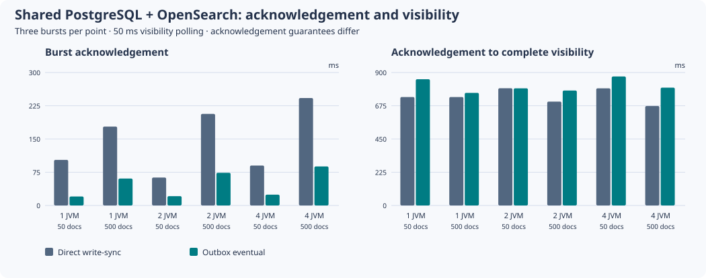

# Shared backend and durable outbox observations — 2026-11-07

All three jobs in [run 42416222318](https://github.com/carstenartur/jgit-storage-hibernate/actions/runs/42416222318)
passed on source `4434f22ee49cd083c11288273ddbcab231628369`.
The workflow, Maven profile and Java fixture in this change match the measured source byte for byte.
[sources.json](sources.json) records each original artifact ID, SHA-256 digest, source-file Git blob
and the SHA-256 hashes of the retained CSV/environment/CPU inputs. All three downloaded archive
digests were verified before extracting these files.

## Workload and consistency

Each topology uses a fresh PostgreSQL 17.10 database and OpenSearch 2.19.5 container, with Temurin
21.0.13+9. One, two or four independent application JVMs share that database and search server.
The JVMs collectively write three 50-document bursts and three 500-document bursts per mode.
The burst size is a total across the JVMs, not a per-JVM size. The two modes run sequentially
inside each job; each topology runs on its own hosted runner.

Direct `write-sync` acknowledgement waits for the backend write. Outbox acknowledgement commits
the ORM rows and durable events; processing and search visibility follow asynchronously. The
acknowledgements consequently offer different guarantees. The visibility measurement begins after
all JVMs acknowledge and polls every 50 ms until the entire burst is visible. It is not a separate
index-refresh event counter or a per-document latency distribution.

## Observed medians

Each cell below is the median of three bursts. These small, single-host observations establish
that the fixture works and measures the tradeoff; they do not establish a production crossover.

| JVMs | Total burst | Direct acknowledgement | Outbox acknowledgement | Direct acknowledgement → visible | Outbox acknowledgement → visible |
| ---: | ---: | ---: | ---: | ---: | ---: |
| 1 | 50 | 102.83 ms | 20.34 ms | 733.94 ms | 854.64 ms |
| 1 | 500 | 178.08 ms | 60.71 ms | 733.91 ms | 762.42 ms |
| 2 | 50 | 63.02 ms | 21.11 ms | 793.76 ms | 793.35 ms |
| 2 | 500 | 206.60 ms | 73.84 ms | 703.35 ms | 778.14 ms |
| 4 | 50 | 90.13 ms | 24.45 ms | 792.98 ms | 873.24 ms |
| 4 | 500 | 242.41 ms | 87.96 ms | 673.05 ms | 797.90 ms |



Outbox acknowledgement is lower in these six comparisons, while the ordinary search refresh
schedule still dominates the later visibility delay. Adding JVMs does not demonstrate a throughput
gain at these small, fixed total burst sizes. Do not add the two reported medians to estimate the
median total latency: the medians can come from different repetitions. The raw rows permit a paired
total-latency calculation if needed.

## Database and network overhead

The shorter acknowledgement carries extra coordination work. For the 500-document bursts,
median PostgreSQL container traffic is about 3.4–3.9 times the direct-mode observation. Search
traffic also increases. These measurements include processing and visibility polling, and each
mode's visibility window has its own duration; they are total observed traffic, not an isolated
cost per database transaction.

| JVMs | Direct PostgreSQL bytes | Outbox PostgreSQL bytes | Direct Search bytes | Outbox Search bytes | Peak allocated outbox relations |
| ---: | ---: | ---: | ---: | ---: | ---: |
| 1 | 172,282 | 583,696 | 404,548 | 457,971 | 392 KiB |
| 2 | 173,020 | 630,229 | 415,885 | 462,025 | 408 KiB |
| 4 | 174,460 | 684,607 | 421,980 | 467,357 | 416 KiB |

Traffic cells are medians of three 500-document bursts. Allocated relation sizes are the maximum
over the topology's observations and include event and agent tables/indexes; an empty queue does
not immediately release those allocated pages. [overhead.csv](overhead.csv) also retains the
50-document burst summaries. PostgreSQL's insert/delete statistics can lag the independently
checked live queue count, so subtracting those cumulative counters is not a reliable backlog.

## Crash, rollback and replay

After the live bursts, the outbox test stops the processors and commits 50 further documents from
one producer with processing disabled. A preceding rolled-back write must leave neither new
projection rows nor events. The test verifies exactly 50 durable pending events and unchanged search
visibility, kills the producer, then boots a fresh cohort. Each topology drains to zero pending
events, restores all 1,700 documents, and retrieves the 50 replayed commits through
`GitHistorySearchService`. Direct mode checks retention of its 1,650 already visible documents.

| JVMs | Direct replacement boot → visible | Outbox replacement boot → visible | Durable events replayed | Remaining events |
| ---: | ---: | ---: | ---: | ---: |
| 1 | 2,247.53 ms | 3,190.36 ms | 50 | 0 |
| 2 | 2,827.20 ms | 4,427.38 ms | 50 | 0 |
| 4 | 4,751.32 ms | 6,738.87 ms | 50 | 0 |

The restart timer includes replacement JVM startup until the complete document count is visible.
Registration of every replacement agent and the drained queue are also verified afterward; the
restart network counter includes those checks. The timer is not pure event-processing time. The
producer is killed before consumption; this does not test a processor crash midway through a batch
or a backend outage.

## Raw data and reproduction

The three directories retain all 42 original CSV observations and their environment/CPU metadata:
[one JVM](1-jvms/outbox.csv), [two JVMs](2-jvms/outbox.csv), [four JVMs](4-jvms/outbox.csv).
[medians.csv](medians.csv) and [restart.csv](restart.csv) are derived by:

```sh
python3 docs/evidence/search-outbox-2026-11-07/reproduce.py
```

The script verifies the retained input hashes and expected burst/restart coordinates before writing
the summaries and chart. PostgreSQL insert/delete statistics are cumulative and can lag the exact
pending-event count. Outbox allocated bytes include both event and agent relations. Network bytes
are each container's ingress plus egress over the measurement window, including visibility polling;
they do not measure an individual write request in isolation.

The [experiment guide](../../operations/search-remote-outbox-experiment.md) gives the native command
and dependency profile. Large remote indexes, representative production RTT, multi-node search,
processor/backend failure and capacity/cost remain follow-up evidence. The production local Lucene
default and its single-writer contract are unchanged.
