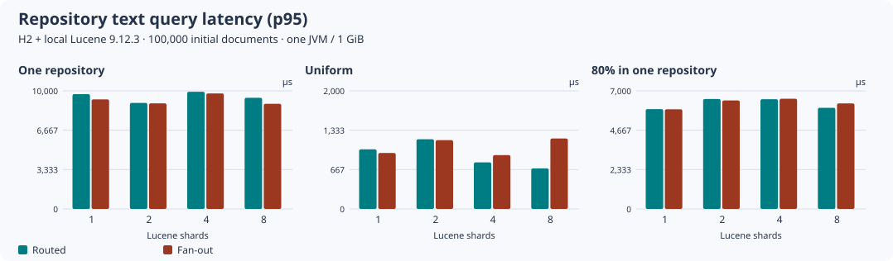
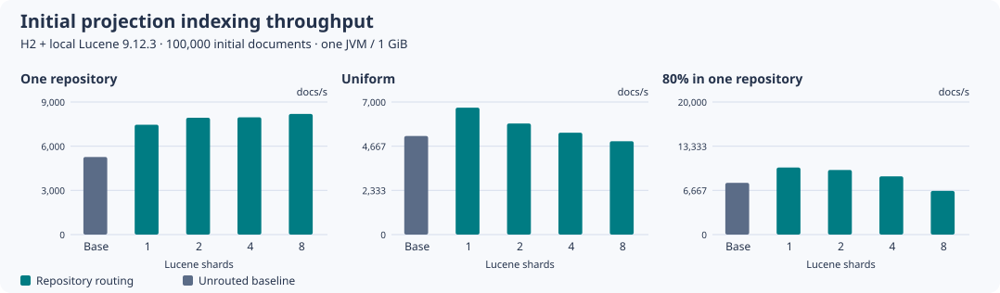
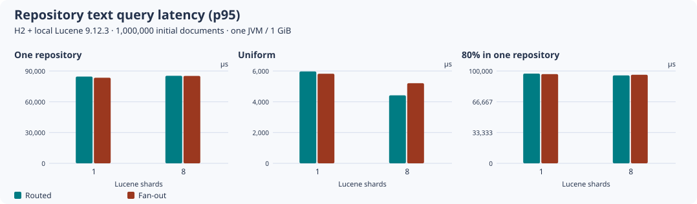
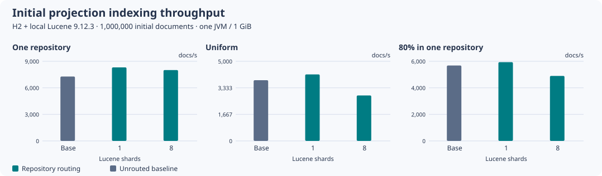

# Repository routing at 100,000 and 1,000,000 projections

Keep the unrouted, single-shard Lucene default. These 48 observations show a useful local query
tradeoff for some uniform repository layouts, but no general reason to enable routing, increase
shards or change the Lucene backend by default. They measure one Search JVM with H2 and local
filesystem Lucene, not PostgreSQL scalability or multiple Search writers.

## Retained evidence and coverage

[Workflow run 42415011355](https://github.com/carstenartur/jgit-storage-hibernate/actions/runs/42415011355)
completed all six jobs at
[`413fed75bb4f61eb839cffccf16874e6d81b8128`](https://github.com/carstenartur/jgit-storage-hibernate/commit/413fed75bb4f61eb839cffccf16874e6d81b8128).
Each job ran stable Lucene 9.12.3 and then `lucene-next` 10.4.0 sequentially. All twelve Maven logs
reported `BUILD SUCCESS`. The [provenance manifest](provenance.json) retains artifact IDs, archive
SHA-256 digests and sizes, source Git blobs, and hashes of the unchanged CSV, environment, CPU and
filesystem files. All six downloaded ZIP digests and all 36 retained files were checked against
their source bytes. Complete Maven logs remain in the linked workflow artifacts.

| Initial projections | Repository layouts | Configurations per backend and layout | Rows across both backends |
| ---: | --- | --- | ---: |
| 100,000 | One repository; 100 uniform; 1,000 with 80% in one | Unrouted baseline; routed 1, 2, 4, 8 shards | 30 |
| 1,000,000 | The same three layouts | Unrouted baseline; routed 1, 8 shards | 18 |

The million-document run did not measure two or four routed shards. The single-repository
artifact names end in `-100` because that is the workflow input for the other layouts; the fixture
and CSV correctly record one repository for `single`. Every configuration starts with a fresh
H2 database and index, inserts the initial corpus and then adds 50 and 500 projections.

- [All 48 unchanged observations with source coordinates](derived/observations.csv)
- [Generated endpoint comparisons](derived/endpoint-comparisons.csv)
- [Generated tables for both backends](derived/tables.md)
- [Raw files and environment provenance](provenance.json)

| Layout and initial projections | Stable raw CSV | `lucene-next` raw CSV | Hosted CPU model |
| --- | --- | --- | --- |
| One repository, 100,000 | [stable](raw/search-routing-single-100000-100/stable/shards.csv) | [next](raw/search-routing-single-100000-100/next/shards.csv) | Intel Xeon Platinum 8573C |
| One repository, 1,000,000 | [stable](raw/search-routing-single-1000000-100/stable/shards.csv) | [next](raw/search-routing-single-1000000-100/next/shards.csv) | AMD EPYC 9V74 |
| Uniform, 100,000 | [stable](raw/search-routing-uniform-100000-100/stable/shards.csv) | [next](raw/search-routing-uniform-100000-100/next/shards.csv) | AMD EPYC 9V74 |
| Uniform, 1,000,000 | [stable](raw/search-routing-uniform-1000000-100/stable/shards.csv) | [next](raw/search-routing-uniform-1000000-100/next/shards.csv) | AMD EPYC 9V74 |
| Skewed, 100,000 | [stable](raw/search-routing-skewed-100000-1000/stable/shards.csv) | [next](raw/search-routing-skewed-100000-1000/next/shards.csv) | AMD EPYC 9V45 |
| Skewed, 1,000,000 | [stable](raw/search-routing-skewed-1000000-1000/stable/shards.csv) | [next](raw/search-routing-skewed-1000000-1000/next/shards.csv) | Intel Xeon Platinum 8370C |

Each CSV has its original `environment.properties` beside it; `cpu.json` and `filesystem.txt` are
retained at the layout directory level. Every job used Temurin 21.0.13, four JVM processors, a
1 GiB maximum heap, H2 files, an ext4 filesystem, synchronous index commit/refresh and batches of
at most 250 projections. The CPU models differ between jobs: comparisons between sizes or
repository distributions cannot isolate the effect of size or distribution.

## Query results and operating costs

The [stable table](derived/tables.md#stable-lucene-9123) shows a qualified benefit for uniform
repositories. At 100,000 projections and eight shards, routed text p95 was 0.687 ms versus 1.193 ms
for the same repository filter without routing, a 42.4% lower point estimate. At one million,
the corresponding values were 4.418 and 5.206 ms, 15.2% lower. Exact-path queries showed the same
direction in these two stable cells: 0.614 versus 0.829 ms, and 4.331 versus 4.544 ms.

Increasing from one routed shard to eight also reduced initial indexing throughput in those
uniform fixtures: 6,704 to 4,932 projections/s at 100,000, and 4,176 to 2,852 at one million.
The committed Lucene file count rose from 107 to 340 and from 89 to 883, respectively. At one
million, the full SQL-to-Lucene MassIndexer rebuild rose from 19.32 to 23.67 seconds. File counts
and merge state are single-run observations, but their cost belongs in the routing decision.

One repository occupied only one shard even when eight were configured. Its stable routed text
p95 was 85.323 ms at one million, compared with 85.209 ms for fan-out on that same index. In the
skewed million-document fixture the busiest shard held 825,481 of 1,000,550 documents, and routed
versus fan-out text p95 was 95.252 versus 95.910 ms. Repository routing cannot split a hot
repository. The cross-repository administrative query can benefit from shard execution too, but
it is a separate workload: for the stable skewed million-document fixture its p95 changed from
104.724 ms at one routed shard to 29.386 ms at eight. The complete CSV retains that result along
with path queries, bursts, heap, storage, purge and rebuild observations.

The [`lucene-next` table](derived/tables.md#next-lucene-1040) includes contrary results. At one
million uniform projections, routed text p95 was 17.788 ms versus 6.263 ms for same-filter fan-out
with one shard, and 6.426 versus 4.753 ms with eight. The eight-shard routing point estimate was
35.2% slower than fan-out. Its path query also regressed, 5.984 versus 4.528 ms. This run does not
diagnose the cause or establish a consistent backend winner. Both versions passed the fixture's
correctness checks, and neither version nor routing becomes the default from this evidence.

### Charts

Each panel uses its own vertical scale. Query bars compare routed and same-filter fan-out queries
within the same configured index; the indexing charts also include the unrouted baseline.









[`lucene-next` 100,000 query chart](derived/next-100000/query-latency.svg) ·
[`lucene-next` 100,000 indexing chart](derived/next-100000/indexing-throughput.svg) ·
[`lucene-next` one-million query chart](derived/next-1000000/query-latency.svg) ·
[`lucene-next` one-million indexing chart](derived/next-1000000/indexing-throughput.svg)

## What the fixture verifies and measures

The measured [runner](../../../jgit-storage-hibernate-search/src/test/java/io/github/carstenartur/jgit/storage/hibernate/search/SearchRoutingPerformanceIT.java)
uses the production `GitCommitIndex` mapping with synthetic fields. The common text token and
exact path match every projection; repository filtering and stable `committerTime`/`objectId`
ordering determine the returned first 20 IDs. The fixture does not time JGit history traversal,
diff parsing or a representative distribution of real search terms.

For every query configuration there are 80 warmup and 200 timed samples. Routed and fan-out
execution order alternates; their first 20 IDs must agree. In the skewed workload every second
query addresses the hot repository, so 80% describes its share of documents, not its share of
query traffic. The other half of the timed queries addresses 100 cold repositories; this does
not measure every repository in the 1,000-repository layout. Uniform queries visit all 100
repositories. The fixture also verifies the total document count, each repository's presence in
only one physical shard, targeted purge isolation, reopen visibility and complete MassIndexer
recovery. The first-hit reopen constructs the production service and runs its routing readiness
check for all repositories.

The metric boundaries are:

- Initial throughput includes ORM persistence, synchronous projection/index commit and refresh.
  The 50-row burst uses one transaction; the 500-row burst uses two. Each burst duration is one
  observation, not a latency percentile.
- `peak_sampled_jvm_heap_bytes` samples whole-JVM used heap every 20 ms during initial bootstrap,
  indexing and querying. It excludes the later reopen, purge and rebuild phases. It is neither
  allocation per operation nor a proof of a constant memory bound.
- `index_bytes`, `files`, `segments` and `h2_bytes` are measured after the initial factory closes,
  before purge/rebuild. The H2 file size includes its allocated storage, not just logical rows;
  these values do not describe PostgreSQL storage or WAL.
- `restart_to_first_hit_ms` is factory/H2 reopen in the same running JVM, followed by readiness
  validation and the first hit. It is not a process restart, database cold start or cleared OS
  filesystem cache. Routed readiness performs checks absent from the unrouted path, so the
  comparison includes that operational cost.
- `routed_purge_and_refresh_ms` covers an index-only purge of the first repository and refresh;
  SQL rows remain. `mass_rebuild_ms` then rebuilds the full index from those rows. These are not
  timings for deleting authoritative Git history or replaying Git through `CommitProjectionRebuilder`.

Each configuration and backend was measured once, in a fixed order, with a fresh index. Baseline
is first; routed shard counts increase; stable precedes `lucene-next`. JIT state, background merges,
filesystem cache, host variation and that order can affect point estimates. The 200 queries are
samples within a trial, not 200 independent benchmark replications or confidence intervals.
No remote backend, outbox workers, networked database, multi-instance throughput, forced failure
or cold-cache crossover is established by this matrix. The separate routing and process-lock
integration tests cover the documented rollback/replay and local writer-safety contracts.

## Reproduce the summary

The raw CSV and environment files are unchanged. The summarizer checks their hashes, all 48
coordinates, required columns, finite positive metrics, percentile ordering, shard/target counts,
heap budget, throughput arithmetic and the environment/source identity before writing results.
It reuses the measured plotting script and retains the exact measured source revision. The Java
benchmark harness is unchanged. Integration also includes the independently tested transaction-start
session cleanup and exact repository-count validation on databases with case-insensitive collations.
The latter uses bounded scalar keyset pages instead of SQL grouping. Its startup query count and
cost differ from the measured version: the retained restart/readiness timings are observations of
the original source, not a rerun of this follow-up. The follow-up also deletes projection keys
selected by exact Java repository identity, coordinating SQL and Search removal in the same
transaction. Retained purge/rebuild timings therefore describe the earlier removal implementation.
Query, indexing and recovery results likewise retain their recorded source identity.

From the repository root:

```bash
python3 .github/scripts/test_summarize_search_routing.py
python3 .github/scripts/summarize-search-routing.py \
  docs/evidence/search-routing-large-2026-11-07 --output /tmp/search-routing-large-replay
diff -ru docs/evidence/search-routing-large-2026-11-07/derived /tmp/search-routing-large-replay
```

The [workflow](../../../.github/workflows/search-routing-performance.yml) can reproduce the
measurement shape. Use 100,000 documents with `baseline,1,2,4,8`, or one million with
`baseline,1,8`, the recorded repository counts, and both backend variants. Additional million-row
shard counts and other repository distributions require new measurements. See the
[operating guide](../../operations/search-routing-and-topology.md) for opt-in configuration,
offline migration and topology choices.
