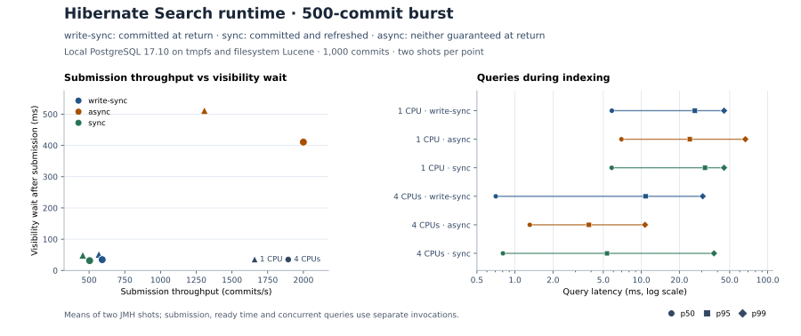

# Search runtime coordination, 1,000 commits and a 500-commit burst

The `async` scenario submitted 500 commits 2.3–3.4 times as fast as `write-sync`, with 411–511 ms of mean visibility wait after submission instead of 35–51 ms. The faster return does not acknowledge a durable or visible index write. `sync` waits for a commit and refresh; it did not consistently improve end-to-end times. Keep `write-sync` as the reference. Use `sync` explicitly when a durable write must be searchable immediately and validate its cost with the application workload.



The two profiles used the same benchmark code, fixture and host. JMH 1.37 ran on Linux x86-64 (AMD EPYC 9V74) and Temurin 21.0.13+9, with Hibernate Search 8.4.0.Final, Lucene 9.12.3 and JDBC 42.7.14. The disposable PostgreSQL 17.10 database used tmpfs, with `fsync` and `synchronous_commit` on. Lucene used the local filesystem; the recovery tests separately use a file-backed database and Lucene index. Treat this as a local comparison, not a disk durability or production throughput result. The benchmark source was this change on top of `3bfa6aff12014b88424c48cf349e33c794e80765`.

| Profile | Allowed JVM CPUs | JVM heap | Retained shots |
| --- | --- | --- | --- |
| `constrained` | CPU 0, `ActiveProcessorCount=1` | 256–512 MiB | [JMH JSON (gzip)](constrained.jmh.json.gz) |
| `normal` | CPUs 0–3, `ActiveProcessorCount=4` | 768–1,024 MiB | [JMH JSON (gzip)](normal.jmh.json.gz) |

Every operation used one fork and two single shots with no warmup. PostgreSQL was not pinned. The raw files retain JMH times, allocation, GC, query sample counts and all secondary observations; only local executable and temporary JVM paths were removed. The workload changes a deterministic 4 KiB file across a single branch. All three scenarios use `content-v1`, projection/JDBC batch size 50, and default Lucene writer RAM and backend threads. `reference` and `sync-sync-r0` have refresh interval 0; `sync-async-r500` allows a 500 ms reader refresh interval. The asynchronous result reflects both the synchronization mode and that refresh setting.

| Profile | Strategy | Submission (commits/s) | Burst ready (ms) | Wait after submit (ms) | Concurrent query p50 / p95 / p99 (ms) | Rebuild ready (commits/s) |
| --- | --- | ---: | ---: | ---: | ---: | ---: |
| `constrained` | `write-sync` | 569 | 1,051.8 | 51.5 | 5.84 / 26.49 / 45.13 | 402 |
| `constrained` | `async` | 1,307 | 930.3 | 511.5 | 6.96 / 24.18 / 66.48 | 501 |
| `constrained` | `sync` | 456 | 884.0 | 48.9 | 5.83 / 31.88 / 45.11 | 328 |
| `normal` | `write-sync` | 592 | 1,366.7 | 34.7 | 0.71 / 10.81 / 30.59 | 457 |
| `normal` | `async` | 2,000 | 647.8 | 410.6 | 1.31 / 3.85 / 10.69 | 1,024 |
| `normal` | `sync` | 504 | 942.4 | 31.6 | 0.80 / 5.35 / 37.58 | 492 |

Rates divide the commit count by mean elapsed time. Wait after submission is measured inside `incrementalBurstReady` and includes at least one verification query. Submission and ready time are separate measurements. Query percentiles are the mean of each shot's percentile during the burst, so they describe these samples rather than an application service level.

| Profile | Strategy | Burst commit generation advance | Segments after close | Index MiB after close | Sum of peak heap pools (MiB) |
| --- | --- | ---: | ---: | ---: | ---: |
| `constrained` | `write-sync` | 11 | 2 | 4.27 | 103.9–115.3 |
| `constrained` | `async` | 1–2 | 2–5 | 4.26–4.30 | 102.3–119.4 |
| `constrained` | `sync` | 11 | 2 | 4.27 | 100.6–115.5 |
| `normal` | `write-sync` | 10–11 | 7–13 | 4.34–4.37 | 250.3–285.3 |
| `normal` | `async` | 1–2 | 3–8 | 4.28–4.34 | 196.5–410.5 |
| `normal` | `sync` | 10 | 12–13 | 4.36–4.37 | 222.7–285.7 |

These ranges are the two `incrementalBurstReady` shots. All 48 shots across both profiles contained exactly 1,000 documents after close. That verifies a drained, graceful close and says nothing about when an async write became durable. The heap figure is an upper bound from separate pool peaks and excludes the fixture setup period. Segment count and commit generation are snapshots, not a count of every merge or refresh.

To repeat the exact subset, build the benchmark with the Maven command in the [operations guide](../../operations/search-runtime-tuning.md), assemble its runtime classpath, then use the existing JMH class. Use a disposable PostgreSQL database: every invocation creates and drops its schema. Set `connection_file` to an owner-readable Java properties file containing `jgit.storage.benchmark.postgresql.url`, `jgit.storage.benchmark.postgresql.user` and `jgit.storage.benchmark.postgresql.password`.

```bash
mvn -B -pl jgit-storage-hibernate-benchmarks dependency:build-classpath \
  -Dmdep.outputFile=target/runtime-dependencies
module=jgit-storage-hibernate-benchmarks
classpath="$module/target/classes:$(cat "$module/target/runtime-dependencies")"
cpus="$(python3 -c 'import os; print(min(os.sched_getaffinity(0)))')"
taskset --cpu-list "$cpus" java -cp "$classpath" org.openjdk.jmh.Main \
  'HibernateSearchRuntimeTuningBenchmark\.' \
  -p commitCount=1000 -p burstCount=500 \
  -p runtimeScenario=reference,sync-async-r500,sync-sync-r0 \
  -f 1 -wi 0 -i 2 -t 1 -foe true -prof gc -rf json -rff constrained.json \
  -jvmArgsAppend "-Xms256m -Xmx512m -XX:ActiveProcessorCount=1 -Djgit.storage.benchmark.connection-properties-file=$connection_file"
```

For the normal profile, select four allowed CPUs, use `-Xms768m -Xmx1024m -XX:ActiveProcessorCount=4` and write to `normal.json`. The hosted workflow offers the remaining scenarios, 50-commit bursts and 10,000-commit histories. These local results do not cover those larger runs, sustained queue saturation or exact Lucene refresh and merge event counts.

The [separate completed hosted matrix](../search-runtime-hosted-2026-11-07/README.md) now retains
all four requested hosted cells, including the full settings family, 10,000-commit histories and
both resource budgets. Keep its results separate from this local comparison: the hosted jobs use
different hosts and database setup. Refresh/merge activity and continuous/overload evidence remain
explicitly outstanding in that report.
