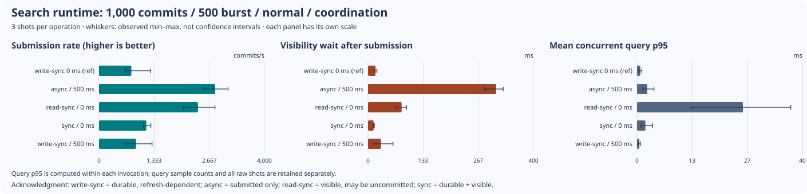
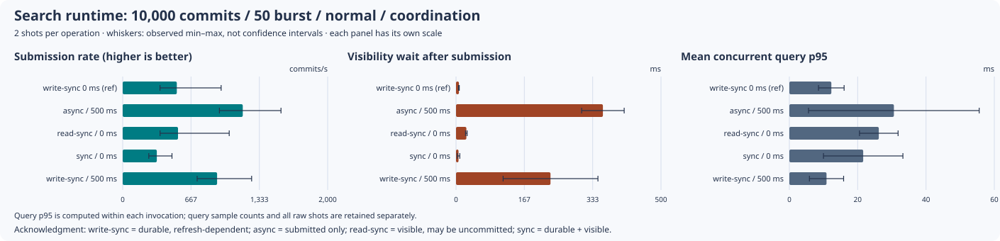
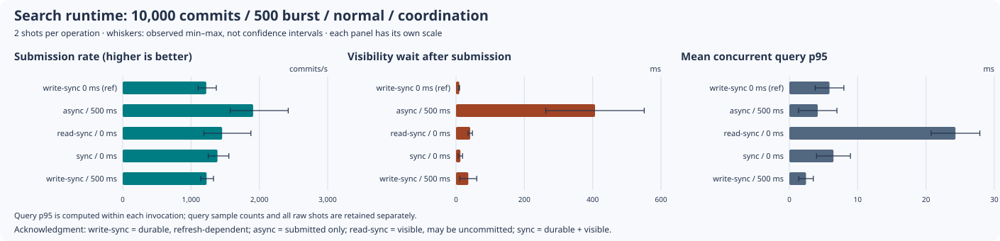
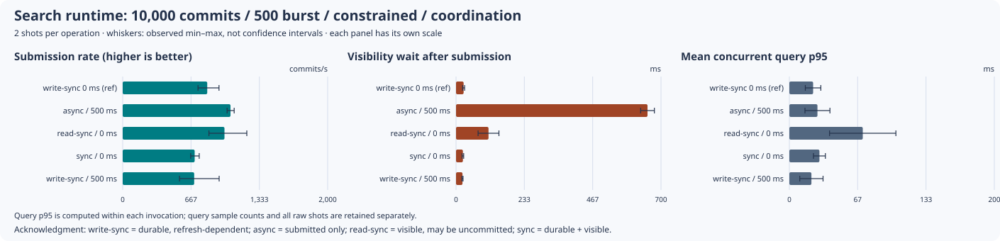

# Hosted Search runtime tuning observations — 2026-11-07

Keep `write-sync` as the production reference. Faster submission under `async` acknowledges a
different state: queued work can still be neither durable nor visible. The hosted measurements
show that submission rate, time until results are visible and concurrent query latency must be
read together. They do not establish a new production profile or a universal writer/batch setting.

## Source, coverage and retained inputs

This evidence comes from corrected
[run 42418358859](https://github.com/carstenartur/jgit-storage-hibernate/actions/runs/42418358859) at
[`3feecec268c0608e440a7169527501fe33590dfd`](https://github.com/carstenartur/jgit-storage-hibernate/commit/3feecec268c0608e440a7169527501fe33590dfd).
The [provenance manifest](provenance.json) retains original artifact IDs, ZIP digests, creation
times, job/gate results, measured source Git blobs and hashes of each retained file. The recorded
15 source blobs were matched against the workflow, Java harness, runner, recovery test, converter,
privacy validator and Maven configuration when collecting the evidence. No Java or benchmark
setting was changed to prepare this report. The consolidated integration also contains separately
reviewed publication, routing and consumer changes; these observations remain attached to the
original measured commit and are not a timing rerun of the combined implementation.

All four benchmark jobs completed successfully, including their privacy checks. The retained
matrix contains **248 scenario/operation records, 660 measured shots and 62 scenario summaries**.
The default reproduction command requires all four successful cells.

| History / burst | JVM budget | Settings matrix | Measured shots per operation/scenario | Retained records |
| --- | --- | --- | ---: | ---: |
| 1,000 / 500 | Four CPUs, 768–1,024 MiB | Full: 41 scenario IDs | 3, after 1 warmup | 164 |
| 10,000 / 50 | Four CPUs, 768–1,024 MiB | Smoke: 7 scenario IDs | 2, no warmup | 28 |
| 10,000 / 500 | Four CPUs, 768–1,024 MiB | Smoke: 7 scenario IDs | 2, no warmup | 28 |
| 10,000 / 500 | One CPU, 256–512 MiB | Smoke: 7 scenario IDs | 2, no warmup | 28 |

Each scenario has four operations: burst submission, burst ready, concurrent queries during the
burst, and an empty-to-complete projection rebuild. Each operation/scenario uses one JMH fork.
The full matrix contains reference, 16 synchronization/refresh combinations, 20 writer RAM/thread
combinations and four batch settings. Some IDs intentionally represent the same settings:
`reference`, `sync-write-sync-r0` and `batch-50` use `write-sync`, refresh 0 and batch size 50.
They remain separate observations, not three independent configurations or a pooled sample.

- [All measured shots and aligned counters](derived/shots.csv)
- [Scenario summary with means and observed ranges](derived/summary.csv)
- [All generated tables](derived/tables.md)
- [Per-operation index, heap, ORM and allocation observations](derived/resource-observations.csv)
- [Reported GC-time observations](derived/gc-time-observations.csv)
- [Exact scenario settings](derived/scenario-settings.csv)

The `raw/<cell>/` directories retain the exact environment, CPU and brief JUnit reports.
`jmh-result.json.gz` and `comparison.json.gz` decompress byte-for-byte to the original artifact
members. Gzip changes only storage, not JMH measurements, paths or fields. Both compressed and
original-byte digests are recorded. Full Maven/JMH logs and XML reports remain in the source
artifacts. Each retained job passed the connection-metadata privacy gate, seven persistent recovery
tests and the native PostgreSQL benchmark integration test.

## Measurements that change the interpretation

### Submission throughput does not measure durability or visibility

In the 10,000-history/500-burst normal cell, the reference submitted 1,222.9 commits/s and reached
complete burst visibility in 424.31 ms. `async` with a 500 ms reader refresh interval submitted
1,908.7 commits/s, while burst-ready time rose to 682.58 ms. The wait measured after submission
inside that ready invocation was 406.87 ms under `async`, compared with 9.49 ms for the reference.
The asynchronous result changes both synchronization and refresh settings; it is not an isolated
test of synchronization alone.

The full 1,000/500 matrix separates the refresh values. For `async`, submission point estimates
ranged from 2,603.4 to 3,079.9 commits/s at refresh 0/100/500/1,000 ms, while post-submission
visibility waits ranged from 154.68 to 974.44 ms. Query behavior also changed: mean per-shot query
p95 was 67.45 ms at refresh 0 and 1.81 ms at 1,000 ms. A cheaper cached-reader query can coexist
with a longer wait for new writes. These are observations from three shots, not service-level
guarantees or a recommended refresh interval.

`sync` waits for index commit and refresh; `read-sync` waits for refresh but can return before
Lucene durability. Both still incur the fixture's verification query when ready time is measured.
The [acknowledgment contract](../../operations/search-runtime-tuning.md#what-a-successful-write-acknowledges)
and recovery tests explain the difference. The hosted PostgreSQL timings and the separate
file-backed HSQLDB process-kill tests answer different questions.

### Small samples and equivalent controls limit rankings

The three equivalent full-matrix controls illustrate run variation. `reference`,
`sync-write-sync-r0` and `batch-50` submitted 782.6, 1,004.6 and 1,130.2 commits/s, respectively,
despite equivalent runtime settings. Those differences prevent treating a single faster cell
as a demonstrated setting improvement. Fresh fork/invocation state, JIT, merging, filesystem
cache and hosted load remain possible influences; this run does not isolate their contributions.

Larger writer buffers and more backend threads did not produce monotonic gains. The complete
20-cell writer family is retained, including slower combinations. For batch sizes, `batch-1`
submitted 135.8 commits/s and reached burst-ready in 3,575.50 ms in the full matrix; `batch-500`
submitted 2,184.6 commits/s and reached burst-ready in 241.89 ms. Both projection transaction size
and Hibernate JDBC batch size change in these scenarios. The result does not justify applying
the largest transaction to every workload, and the three-shot controls limit a precise ranking.

The constrained 10,000/500 cell supplies a concrete counterexample to a general batch increase.
Its reference submitted 825.2 commits/s with mean per-shot query p95 of 23.17 ms. `batch-250`
submitted 501.0 commits/s with query p95 of 291.91 ms, based on 13–27 queries per invocation.
The normal-budget cell's `batch-250` point estimate was faster than its reference submission rate.
These are separate hosts and few-shot results, so they do not isolate a universal CPU/heap
threshold; they do show why a faster setting in one cell cannot be promoted for every budget.

### Query percentiles need their sample counts

The query operation samples an already indexed search term while the producer submits the burst.
It continues until the producer is done and at least five queries have run, then separately waits
for the new burst to become searchable. An asynchronous producer can return while indexing remains
queued, so the measured query window need not cover all later background work.
The `query_operation_ms_*` CSV columns describe the entire `steadyQueriesDuringBurst` invocation,
including that later visibility wait and executor cleanup; they are not the duration of the query
sampling loop alone.

At 10,000/50, the `async` query invocations contained only 5–20 queries; several scenario p95/p99
values are therefore the slowest or nearly slowest observed query. The report averages each
invocation's p50/p95/p99; it cannot recover a pooled percentile because individual query latencies
are not retained in JMH. The query sample range is displayed alongside every table row. Likewise,
two or three operation shots do not establish an application p95/p99 latency. Charts use means
and observed min–max whiskers, not confidence intervals.

## Charts

Each chart compares submission rate, post-submission visibility wait and mean per-invocation
query p95 for the same cell. These columns come from different benchmark operations; they are not
three phases of one shared timing sample. Each panel has its own axis scale.









[All synchronization/refresh combinations](derived/1000-500-normal-full/synchronization.svg) ·
[All writer RAM/thread combinations](derived/1000-500-normal-full/writer.svg) ·
[Batch comparisons](derived/1000-500-normal-full/batch.svg)

## Environment and metric boundaries

The jobs use Temurin 21.0.13+9, JMH 1.37, Hibernate Search 8.4.0.Final, Lucene 9.12.3,
PgJDBC 42.7.14 and a PostgreSQL 17.10 Alpine Testcontainers database. Lucene uses a local
filesystem directory. The hosted fixture has no explicit tmpfs override; these hosted results
must not inherit the tmpfs description of the earlier local 1,000-commit run. The benchmark JVM
is pinned to the recorded CPU mask and sets `ActiveProcessorCount`; PostgreSQL is not pinned
with it. CPU models and complete runner metadata are retained per cell.

The 1,000/500 full and 10,000/50 normal jobs used AMD EPYC 9V74 hosts; 10,000/500 normal used
AMD EPYC 9V45 and 10,000/500 constrained used AMD EPYC 7763. Workload, resource and host changes must be considered together; cross-cell
differences do not isolate a hardware-independent scaling law.

All operations use the same `content-v1` semantic profile and a deterministic Git history that
changes a 4 KiB file. Burst setup indexes the preceding history. Rebuild starts empty and checks
the entire expected history, not only its burst suffix. Each invocation creates its own fixture;
setup and teardown are outside the primary operation timer. The public result contracts are:

- Submission elapsed time measures the application-thread submission path. Visibility is verified
  during unmeasured teardown. It cannot be subtracted from a separately measured ready operation
  to obtain a paired visibility lag.
- Ready time includes submitting/indexing the burst and polling for all new hits. The auxiliary
  visibility wait starts after submission in that same invocation and includes verification-query
  cost. The query operation and full rebuild have their own independent visibility checks.
- Rebuild throughput divides the full history count by mean empty-to-complete rebuild-ready time.
  Burst throughput divides burst count by mean submission time. Rates are not means of individual
  inverse times.
- AuxCounter `score` fields can sum invocations. All report arithmetic uses `rawData`, including
  query-percentile means, transactions, statements, generation changes and heap observations.
- Committed document count, segments and referenced Lucene bytes are measured after graceful
  close. Generation advance is the difference from setup to close. These snapshots do not count
  every refresh or merge, nor prove that an earlier `async` acknowledgment was durable.
- The heap counter sums individual heap-pool peaks reset after setup and sampled before close.
  Peaks can occur at different times, so the sum is an upper bound, not a simultaneous heap sample
  or allocation per operation. It must not be compared with the JVM cap as if it were one sample.
- JMH allocation and GC measurements include setup/teardown costs. In the full matrix `gc.time`
  can have fewer raw observations than measured shots. `gc-time-observations.csv` keeps those
  values and their count separately; it invents neither zero values nor an association with a
  particular operation shot. The remaining dense profiler fields are retained with the shots.

This matrix does not test sustained queue saturation, a remote Search backend, distributed
Search writers, exact merge/refresh event counts, or machine power loss. The recovery fixture
separately verifies process-kill, interrupted rebuild and injected index-I/O failure behavior.
No runtime default or named production profile changes as a result of this report.

## Remaining requested evidence

[Issue #196](https://github.com/carstenartur/jgit-storage-hibernate/issues/196) also requests
Lucene commit/refresh/merge activity and continuous incremental indexing with concurrent queries.
This report retains commit-generation advances and final segment snapshots, but it does **not**
observe refresh or merge activity. Those snapshots cannot supply the missing activity metrics.
Its concurrent workload is an end-limited 50/500-commit burst, not a continuous or queue-overload
experiment. The [existing issue follow-up](https://github.com/carstenartur/jgit-storage-hibernate/issues/196#issuecomment-5228938653)
also explicitly leaves overload cases outstanding. The completed matrix and persistent recovery
tests are retained progress; these remaining scope items must stay explicit when assessing the issue.

## Reproduce the report

Python's standard library is sufficient; no Java benchmark runs during reproduction. The script
checks input sizes/digests, successful jobs and privacy gates, environment identity, the complete
four-cell/scenario/operation matrix, shot counts/units, finite values, expected committed documents,
visibility and concurrent-query invariants before producing output.

```bash
python3 docs/evidence/search-runtime-hosted-2026-11-07/test_reproduce.py
python3 docs/evidence/search-runtime-hosted-2026-11-07/reproduce.py \
  --output /tmp/search-runtime-hosted-replay
diff -ru docs/evidence/search-runtime-hosted-2026-11-07/derived /tmp/search-runtime-hosted-replay
```

The raw dashboard comparison files also reproduce with the measured
[converter](../../../.github/scripts/convert-jmh-search-runtime.py) and raw JMH JSON. The
[operations guide](../../operations/search-runtime-tuning.md) documents native workload selection,
CPU budgets, acknowledgment semantics and the persistent failure tests. The
[earlier local comparison](../search-runtime-2026-11-07/README.md) remains separate because its
host/database setup, scenario subset and resource pairing differ.
