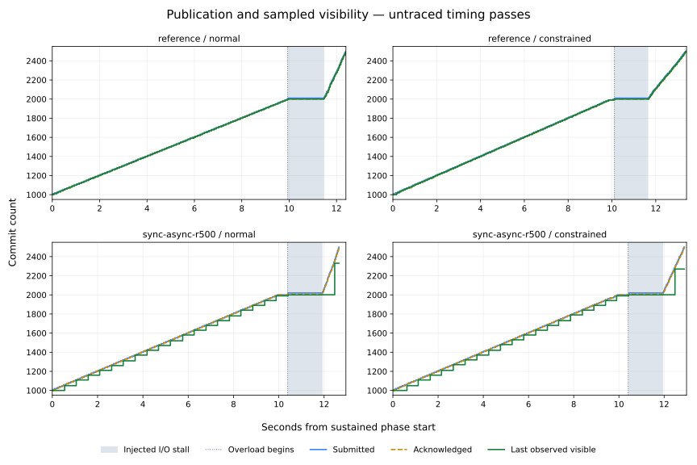
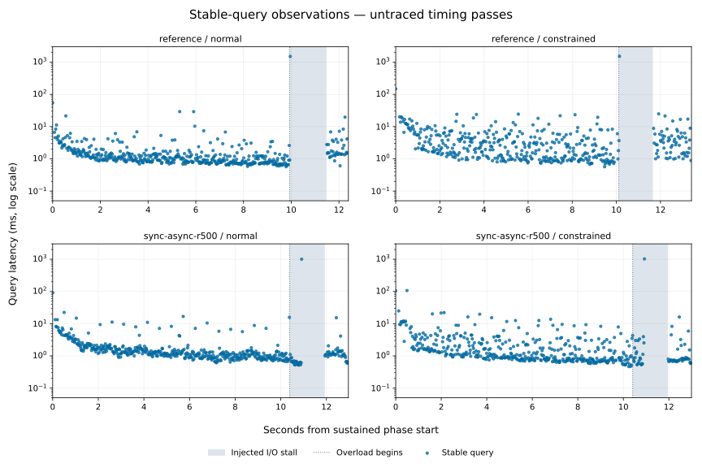
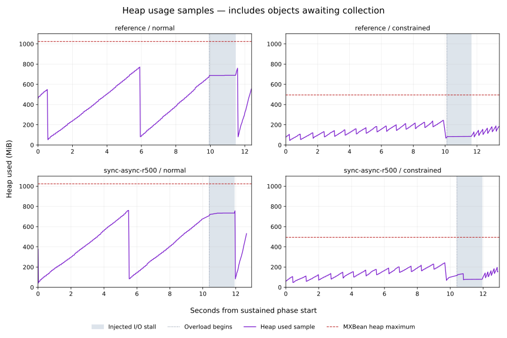

# Sustained publication, overload and Lucene activity — 2026-11-08

The four hosted coordinates completed both their untraced timing pass and their
separate activity-trace pass. Every pass verified the same **2,500 Git, SQL and
Lucene identities before and after persistent reopen**, with 150 incremental
transactions, zero reported background failures and no surviving application
workers. This supplies the sustained publication, concurrent queries, overload
and phase-attributed Lucene activity requested by
[issue #196](https://github.com/carstenartur/jgit-storage-hibernate/issues/196).
It supports completing the bounded evaluation while retaining the safe reference
and declining a new default or named performance profile. These observations do
not establish a throughput winner or an end-to-end visibility guarantee.

## Immutable run and retained material

- [Run 42431132661](https://github.com/carstenartur/jgit-storage-hibernate/actions/runs/42431132661),
  attempt 1, started 2026-11-08 00:44:30 UTC and completed successfully by 00:49:19 UTC.
- Actual measured checkout: **`5ed8aad0f0691bcecb414b319235b67dc0520581`**;
  full source tree: **`8a6035b7563d2901bf8d34f62f2c879bc1cb0601`**.
- The local evidence branch begins at `f293b74420fdf23069449d3cdce324d38d1b3338`,
  whose full tree is identical. That local commit is not substituted for the
  actual measured checkout.
- The exact validation-branch push selected four dedicated sustained jobs.
  The larger JMH matrix and history publisher were skipped as intended. All
  four native, source, privacy and upload gates passed.

The four original ZIPs are retained byte-for-byte. Their digests, lengths,
artifact IDs, job gates and exact source blobs are recorded in
[provenance.json](provenance.json). The API artifact digest was checked before
extraction. The replay below also verifies all raw-file hashes, 16 retained source
blobs, all **28 unskipped JUnit test cases** across the four jobs, and all
**24 original derived files byte-for-byte**. The 28 cases are repeated executions
of seven diagnostic/fixture tests; they are not 28 different test designs.

| Coordinate | Job | Original retained archive |
| --- | --- | --- |
| Reference / normal | [128580046435](https://github.com/carstenartur/jgit-storage-hibernate/actions/runs/42431132661/job/128580046435) | [ZIP](archives/search-runtime-sustained-reference-normal.zip) |
| Reference / constrained | [128580046215](https://github.com/carstenartur/jgit-storage-hibernate/actions/runs/42431132661/job/128580046215) | [ZIP](archives/search-runtime-sustained-reference-constrained.zip) |
| Async / normal | [128580046328](https://github.com/carstenartur/jgit-storage-hibernate/actions/runs/42431132661/job/128580046328) | [ZIP](archives/search-runtime-sustained-sync-async-r500-normal.zip) |
| Async / constrained | [128580046364](https://github.com/carstenartur/jgit-storage-hibernate/actions/runs/42431132661/job/128580046364) | [ZIP](archives/search-runtime-sustained-sync-async-r500-constrained.zip) |

Each ZIP contains both raw passes, the original hosted summaries and activity
tables, CPU inventory, Maven logs and JUnit XML/text reports. The retained
[sources.tar.gz](sources.tar.gz) contains the exact workflow, diagnostic,
scenario, parser/privacy code, tests and POMs used by this study. Its individual
Git blob IDs and SHA-256 values are in the manifest. All extracted raw records,
logs and JUnit files pass the original privacy scanner independently of the
hosted gate.

## Fixed workload, settings and resources

Each coordinate runs `timing` first and `trace` second in the same JVM and
PostgreSQL container. Each pass starts with fresh projection tables and a fresh
filesystem Lucene index. No database or OS cache flush is performed between
passes. The synthetic history is deterministic; replay verifies identical,
ordered Git object IDs across all eight passes.

After 1,000 seed commits, the producer publishes 100 batches of ten commits,
paced at 100 ms intervals. A concurrent worker queries ten stable seed hits and
then observes the total visible count. After the sustained phase drains, the
harness injects an output stall and publishes another 50 batches without pacing.
Every pass ends at 2,500 commits. The output-creation gate is held for at least
1.5 seconds, then released before producer/visibility drain, verification,
provider close and persistent reopen. The
[runtime guide](../../operations/search-runtime-tuning.md#bounded-sustained-and-overload-diagnostic)
describes the lifecycle and failure-path checks.

| Setting | Reference | `sync-async-r500` |
| --- | --- | --- |
| Indexing synchronization | `write-sync` | `async` |
| Query-driven refresh interval | 0 ms | 500 ms |
| Shared diagnostic limits | One backend thread; one queue of eight slots; 16 MiB writer buffer; `max_buffered_docs=20` | Same limits |

These deliberately small limits expose I/O and queue interactions. They are not
production recommendations, and this diagnostic's reference is not the unchanged
settings of the earlier JMH reference. The commit interval is unchanged from the
pinned Search default; synchronous work can force commits independently of it.

| Coordinate | Host CPU model from retained `cpu.json` | JVM CPUs / affinity | Initial / launch maximum heap | Reported MXBean heap maximum |
| --- | --- | --- | --- | ---: |
| Reference / normal | Intel Xeon Platinum 8573C | 4 / `0-3` | 768 / 1,024 MiB | 1,024 MiB |
| Reference / constrained | AMD EPYC 7763 | 1 / `0` | 256 / 512 MiB | 494.938 MiB |
| Async / normal | AMD EPYC 7763 | 4 / `0-3` | 768 / 1,024 MiB | 1,024 MiB |
| Async / constrained | AMD EPYC 9V74 | 1 / `0` | 256 / 512 MiB | 494.938 MiB |

All four hosts report four logical CPUs. Affinity and `ActiveProcessorCount`
bound the Java process; the PostgreSQL container retains its host allocation.
The initial and maximum flags are retained in the exact workflow/JUnit runtime
record. `heap.max.bytes` is the effective maximum reported by the JVM memory
MXBean, which is slightly below the 512 MiB launch setting in the constrained
jobs. No particular GC implementation is inferred from this difference.

The recorded versions are Java `21.0.13+9-LTS`, Hibernate Search `8.4.0.Final`,
Lucene `9.12.3`, PostgreSQL `17.10` and JDBC driver `42.7.14` on Linux amd64.
All eight passes record actual `SHOW` values **`fsync=on`,
`synchronous_commit=on`, `full_page_writes=on`**. The container command explicitly
sets these values, and both the harness and replay reject missing/off settings.
This new evidence does not change the database conditions of an older study.

## Timing observations

The table below uses only the untraced timing passes. It contains **one bounded
pass per coordinate on separate hosts**, with no confidence intervals. Different
host CPU models, scheduling, JVM heap ergonomics, caches and warm-up prevent
attributing point differences solely to synchronization or resource limits.

| Scenario / resources | Achieved sustained commits/s | Sustained query samples | Query p95, ms | Post-gate producer + visibility drain, ms | Blocked queue submission observed |
| --- | ---: | ---: | ---: | ---: | --- |
| Reference / normal | 100.636 | 448 | 4.190 | 926.569 | No |
| Reference / constrained | 98.913 | 392 | 13.331 | 1,752.874 | Yes |
| Async / normal | 100.599 | 442 | 6.674 | 1,044.599 | Yes |
| Async / constrained | 100.817 | 413 | 9.518 | 1,048.322 | Yes |

The approximately 100 commits/s achieved rate follows the imposed pacing; it
does not estimate peak service capacity. All four timing passes contain
concurrent sustained queries. The gate lasted 1,504–1,510 ms in those passes.
The complete publication and query latency distributions, including the
overload/drain tails, are in [latencies.csv](derived/latencies.csv). Percentiles
are nearest-rank individual observations, not means of JMH percentiles.

Publication timing covers Git ref advance plus the incremental indexer, excluding
history-object preparation. Stable-query timing excludes the subsequent
visibility-count query. Queries are grouped by their starting phase, and can
finish after that phase changes. A query stalled during the output gate is a
real observed tail, not a failure to complete the diagnostic.



The green series is the last completed query worker's visibility observation.
It can remain stale after the owner has begun its independent drain/verification.
Its last plotted point is not the final membership oracle: all eight completed
passes separately prove the full 2,500 identities before and after reopen.



### Backpressure, lag and heap interpretation

All four async timing/trace passes prove a producer blocked in a backend queue
submission while the actual Lucene output gate is held. The raw samples identify
`BlockingQueue.put`/`offer` under Hibernate Search's `BatchingExecutor.submit`;
configuring eight slots alone is not treated as evidence of saturation.

Queue waiting is **not exclusive to async**. It was also observed in the
constrained reference timing pass, where a transaction submits ten documents to
an eight-slot queue. The other reference passes did not capture that wait state.
Their gated producers still remained incomplete and resumed after release.
Neither an unobserved stack state nor the synchronization setting establishes
that submission can never block.

| Timing coordinate | Largest acknowledged − last observed visible count | Maximum visibility-observation age, ms | Sampled maximum heap used, MiB |
| --- | ---: | ---: | ---: |
| Reference / normal | 10 | 1,517.084 | 771.734 |
| Reference / constrained | 10 | 1,541.454 | 244.276 |
| Async / normal | 339 | 1,018.428 | 761.064 |
| Async / constrained | 269 | 1,032.963 | 242.338 |

The difference between acknowledgements and the last observation is **not an
internal queue depth**. The corresponding observation age matters when a query
is stalled. A 500 ms refresh interval is not an end-to-end visibility SLA.

Heap values are samples of `MemoryMXBean.heap.used`. They include objects awaiting
collection; they are not retained live memory, instantaneous peaks or a proof of
constant memory use. The normal and constrained initial heaps differ, so the
roughly 770 versus 244 MiB samples do not establish a proportional memory saving
from the resource setting. GC counters in [observations.csv](derived/observations.csv)
are labelled cumulative for the whole diagnostic JVM, including setup, queries
and sampling. The trace pass follows the timing pass in that JVM; those counters
must not be treated as isolated per-pass deltas.



**Wording correction:** the original hosted `summary.md` files say “Sampled
maximum live heap”. Those original bytes remain unchanged in the ZIPs and are
replayed with the exact original renderer. This report and the future renderer
use “Sampled maximum heap used” to describe the actual counter. No value or
historical timing was rewritten.

## Separately captured Lucene activity

The instrumented pass captures pinned Lucene InfoStream messages. Its timing
includes logging overhead and is not ranked against the earlier timing pass or
the separate JMH study. The retained source parser attributes each event to the
phase active at its event timestamp.

| Trace coordinate, sustained phase only | Commit publications | Completed NRT reader-open work | Merge installations |
| --- | ---: | ---: | ---: |
| Reference / normal | 100 | 115 | 12 |
| Reference / constrained | 100 | 112 | 11 |
| Async / normal | 10 | 18 | 6 |
| Async / constrained | 10 | 19 | 6 |

These are three distinct observations. A commit publication is the
`segments_N` publication event; it does not equate a caller acknowledgement with
fsync durability. Completed `getReader` work is not proof that Hibernate Search
published a different reader. A merge installation is the writer's successful
segment-state update after `commitMerge`, not a durable commit. Merge starts,
codec duration messages and aborted work do not count as installations, and an
installation timestamp does not recover a merge duration.

The full [activity table](derived/activity.csv) preserves setup, sustained,
sustained drain, overload, post-gate drain, verification, close and reopen
separately. In particular, one async/constrained commit publication occurred
during verification; it is not reassigned to sustained work or close. Timing-pass
activity fields are null/blank, meaning **unobserved**, rather than zero events.
The trace counts establish that commit, reader and merge activity was observed;
they do not isolate its CPU cost or justify a universal refresh/merge rate.

## Decision against the original issue scope

The prior [hosted settings study](../search-runtime-hosted-2026-11-07/README.md)
retains its own source, workload, database qualification and matrix results. The
existing recovery tests and runtime guide supply failure-handling,
acknowledgement/durability, rebuild, restart and interruption contracts. This
follow-up supplies the previously missing sustained-plus-query workload,
explicit overload/drain observation and separately attributed activity under
both resource budgets. It does not rerun or relabel the earlier matrix.

The result supports retaining the backward-compatible `write-sync` behavior and
requiring an explicit failure/reconciliation plan for async use. No new default,
named tuning profile, universal throughput claim, maximum-lag promise or
peak-memory guarantee follows. Poor tails and sampled lag are retained as
evaluation outcomes; identity loss, missing activity, a failed drain/reopen or
worker leakage would instead have invalidated completion. None occurred in the
eight validated passes.

For issue #196, these valid bounded observations complete the concrete remaining
workload/activity requirements. The original issue does not require an indefinite
soak, a positive async speedup, a new default, or hardware power-loss testing.
Further deployment tuning and any future default promotion need their own
evidence; they are not silently claimed by this completion.

## Reproduce and inspect

From the repository root, Python 3.9+ is sufficient for archive/source validation
and all tables. Matplotlib is needed only for the optional SVG plots (rendered
here with version 3.10.8).

```bash
python3 docs/evidence/search-runtime-sustained-2026-11-08/test_reproduce.py
python3 docs/evidence/search-runtime-sustained-2026-11-08/reproduce.py \
  --output /tmp/search-runtime-sustained-replay
# Optional figures:
python3 docs/evidence/search-runtime-sustained-2026-11-08/reproduce.py \
  --output /tmp/search-runtime-sustained-replay --plots
```

This performs no Java execution, database access, network access or new timing
study. It checks all four original archive hashes before extraction, rejects
duplicate/missing coordinates and unsafe archive paths, verifies all 16 source
blobs, scans every extracted artifact for connection details, checks every JUnit
suite for failures/skips, and validates/replays the raw evidence with the exact
measured parser. It then checks that all eight membership fixtures agree and
writes qualified observation/latency/activity tables and
[verification.json](derived/verification.json). The wrapper's four focused
regression tests cover missing/duplicate coordinates, archive corruption and
path traversal, and a JUnit failure element concealed by an incorrect zero
summary counter. The initial missing-implementation run and then the concrete
JUnit element regression both failed before their fixes; all four now pass.
Their retained [red](review/replay-junit-red.txt) and
[green](review/replay-green.txt) logs distinguish that concrete parser regression
from the initial missing-implementation check.

The plots show only the untraced sustained-through-drain window. All pass
summaries and phase distributions remain in [observations.json](derived/observations.json),
so omitted setup/close points and instrumented timings remain inspectable.
The replay temporary directory is removed after validation; neither original
archives nor their raw/hosted derived contents are changed.
