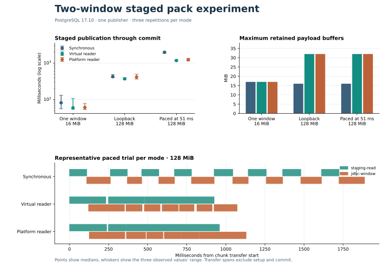

# Bounded staging pipeline experiment

The experiment transfers an already staged, deterministic payload into a pack extension inside one Hibernate transaction. It uses the existing chunk writer and reopens the committed extension through the repository's chunk reader. Every measured publication verifies all bytes by SHA-256. These results cover the transfer through commit. Git pack construction, ref publication and protocol negotiation have separate costs. [Synchronous staging trace](../../operations/staging-jdbc-evidence.md)

## Two windows and one database writer

The synchronous reference uses one reusable payload window. Each pipeline uses two windows, one reader thread and a bounded handoff with at most one outstanding read. Both pipeline variants use the same transfer code and change the reader thread factory. The owning transaction thread performs the Hibernate calls, and a single-window publication takes the synchronous path.

Tests force overlap, reader failure and writer failure. An active prefetch is interrupted and joined before a writer failure returns. Reader failure reaches the transaction owner before a later window can be written. HSQLDB tests roll back both the parent pack and previously flushed chunks after either a staging failure or a real database constraint failure. A successful result is returned after commit.

## One-publisher measurements

The trial rotates mode order across three repetitions. Times show the median in milliseconds and the range in brackets. Buffer bounds include staged chunk bytes in live windows. JVM heap sampling uses the sum of per-pool peaks, whose maxima may occur at different times. Process CPU and allocation are separate observations.

| Payload / window | Storage and connection | Synchronous | Virtual reader | Platform reader | Buffer bound |
| --- | --- | ---: | ---: | ---: | ---: |
| 16 MiB / 32 MiB | Runner staging file, direct 0.078 ms RTT | 82.4 [56.6–132.4] | 59.9 [54.5–108.1] | 61.0 [53.6–79.0] | 17 MiB per mode |
| 128 MiB / 16 MiB | Runner staging file, direct 0.081 ms RTT | 428.6 [400.3–488.3] | 372.4 [355.6–401.1] | 415.8 [367.4–500.4] | 16 / 32 / 32 MiB |
| 128 MiB / 16 MiB | 150 MiB/s paced reads, 50.967 ms RTT | 1,993.3 [1,864.1–1,999.6] | 1,181.3 [1,151.1–1,232.5] | 1,237.7 [1,168.2–1,358.1] | 16 / 32 / 32 MiB |

The paced trials show 707–765 ms median overlap and a 38–41% lower median staged-publication time for the two readers. Allocation rose from 144 to 160 MiB and process CPU rose from 150 ms to 230–250 ms. The virtual and platform time ranges overlap. The direct trials and the single-window control illustrate variation in timings at this sample size, including timing variation between modes that use the same path.



## Scope and reproduction

The measured library revision is `3bfa6aff12014b88424c48cf349e33c794e80765` with the benchmark sources accompanying this report. The disposable PostgreSQL 17.10 instance used tmpfs, `fsync=on`, `synchronous_commit=on` and WAL/I/O timing. The staging files were on the runner filesystem. Toxiproxy 2.12.0 applied fixed 25 ms delays in both directions for the paced cell. A persistent `SELECT 1` connection measured RTT. The AMD EPYC 9V74 runner had an eight-CPU quota. Maven used JDK 25 and forked Temurin 21.0.13 with a 768 MiB heap cap.

The experiment lives in the benchmark test sources. The existing production writer stays synchronous. The result supports more evaluation where staged reads and JDBC writes both account for substantial elapsed time. Production decisions need the complete Git publication path and representative concurrency and storage.

| Profile | Timings and process measurements | Phase timeline | Native observations |
| --- | --- | --- | --- |
| Direct 128 MiB | [Trials](direct-128/trials.csv) | [Timeline](direct-128/timeline.csv) | [PostgreSQL](direct-128/database-telemetry.json) |
| Paced 128 MiB | [Trials](paced-128-rtt50/trials.csv) | [Timeline](paced-128-rtt50/timeline.csv) | [PostgreSQL](paced-128-rtt50/database-telemetry.json) |
| Single window | [Trials](one-window-16/trials.csv) | [Timeline](one-window-16/timeline.csv) | [PostgreSQL](one-window-16/database-telemetry.json) |

The PostgreSQL CI smoke uses the existing benchmark workflow. Run a local cell with Docker and Java 21 or newer after building the reactor dependencies:

```bash
mvn -B -pl jgit-storage-hibernate-benchmarks -am install -DskipTests
prefix=jgit.storage.benchmark.staging-pipeline
mvn -B -pl jgit-storage-hibernate-benchmarks test \
  '-Dtest=StagedChunkPipelineEvidenceTest#recordsPostgresqlPipelineEvidence' \
  "-D$prefix.enabled=true" "-D$prefix.payload_mib=128" "-D$prefix.window_mib=16" \
  "-D$prefix.writers=1" "-D$prefix.repeats=3" "-D$prefix.output=$PWD/target/staging-pipeline"
```

The runner accepts 16, 128 and 512 MiB payloads, 16 and 32 MiB windows, and 1, 4 or 16 publishers. Each payload includes a 257-byte tail. Select staging placement with the fork's `java.io.tmpdir` and pace reads with `read_mib_per_second`. For a shaped run, supply a **disposable loopback PostgreSQL database** named `jgit_stage_pipeline_disposable` with local user `benchmark`. The benchmark recreates its mapped tables between trials. Set `JGIT_STAGING_PIPELINE_DISPOSABLE_JDBC_URL` to the shaped route and `JGIT_STAGING_PIPELINE_DIRECT_JDBC_URL` to the unshaped route for telemetry. Set `requested_rtt_millis` to 5, 20 or 50 according to the proxy configuration. CI runs the small direct cell.
