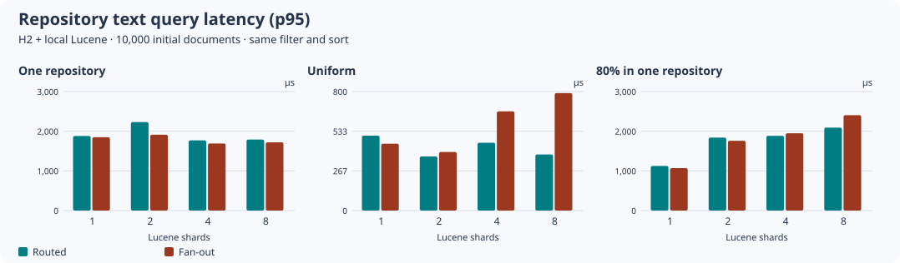
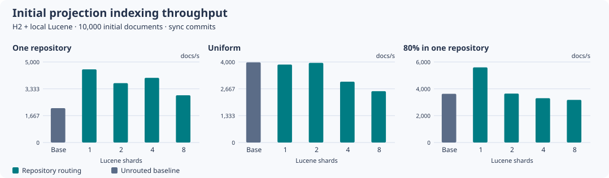

# Repository routing and Search topology

Keep one local Lucene index on one active Search node by default. Repository routing is opt-in and
can be used with one physical index; adding shards is a separate choice. Sharding divides the
index on that node. It does not distribute writes across application instances.

## Enable repository routing

For an evaluation, add this Hibernate property to the application-owned `SessionFactory`:

```properties
hibernate.search.mapping.configurer=class:io.github.carstenartur.jgit.storage.hibernate.search.RepositoryRoutingMappingConfigurer
```

With the Spring Boot starter, put the same key in `jgit.storage.hibernate.hibernate-properties`.

The configurer binds `GitCommitIndex.repositoryName` as its exact, immutable routing key and uses
an independent index named `GitCommitIndexByRepository`. The ordinary `GitCommitIndex` index and
its on-disk documents remain compatible when the configurer is absent. Repository name comparisons
still use the explicit repository filter: different repositories can hash to the same shard. Text,
path, compact projection and scrolling searches all route when enabled. Structured-only HQL search
is unaffected. Routing can change Lucene's corpus statistics, so relevance order can differ from a
fan-out query; use a stable field sort when comparing hit sets across layouts.

The configurer uses one physical index unless hash sharding is configured for this index. For
example, add the following to test four physical shards:

```properties
hibernate.search.backend.indexes.GitCommitIndexByRepository.sharding.strategy=hash
hibernate.search.backend.indexes.GitCommitIndexByRepository.sharding.number_of_shards=4
```

Repository-scoped ORM deletion continues to remove documents after the relational transaction
commits. The routing bridge targets the repository shard for those removals. A Git history rebuild
also sweeps documents left behind by an earlier failed index operation. It purges the selected
routing key after the bounded relational deletions and refreshes before replaying reachable commits.
The purge cannot remove another repository's documents, including on a shared shard. Stop writers
for that repository until the rebuild completes. A failure can leave a partial derived projection;
rerun the rebuild to clear and replay it. Do not use the Search workspace's index-only purge to
delete authoritative Git history or relational projection rows.

## Switch an existing index or change the shard layout

Do this offline, including a switch from an unrouted index to a one-shard routed index. Hibernate
Search records the routing key inside each document; the old documents do not have it. A layout
change can leave the total hit count unchanged while making documents unreachable via their keys.

1. Pause Search reads and projection writes. Keep the database and its `git_commit_index` rows.
2. Configure the new mapping and shard count with a fresh index root. Keep the previous derived
   directory separately if you need it for diagnosis. Do not start a second writer on either root.
3. Open a maintenance `SessionFactory` with Search enabled, then reindex the relational projection:

   ```java
   Search.mapping(sessionFactory)
       .scope(GitCommitIndex.class)
       .massIndexer()
       .failFast(true)
       .startAndWait();
   ```

4. Construct `GitHistorySearchService` and verify known repository hits before resuming traffic.
   With routing enabled, the service checks the total and each repository's routed document count
   against the database once per factory. A mismatch stops service construction. The check is a
   topology/readiness check and assumes writes are paused during startup; it does not compare
   document IDs or detect every kind of drift after startup.

If reindexing is interrupted, keep traffic paused and run the full MassIndexer again. If Git history
itself has not been projected correctly, rebuild that repository from Git instead of mass indexing
the incorrect rows. To switch back after a routed index received writes, rebuild the unrouted index
from current relational rows before using it; the old index directory may be stale. See the separate
[document identifier upgrade](search-index-upgrades.md) for the older numeric-ID migration.

## Local shard measurements

The [dispatchable workflow](../../.github/workflows/search-routing-performance.yml) runs with one local
Search JVM with a file-backed H2 database and a fresh file-backed Lucene index. It compares
the default unrouted baseline with 1, 2, 4 and 8 routed shards for one repository, uniform repository
sizes and an 80% hot repository. The hosted inputs support 10,000, 100,000 and 1,000,000 documents and
10, 100 or 1,000 repositories for the two multi-repository layouts. A push to a deliberate
`benchmark/search-routing-full-198-*` branch runs both Lucene versions at 100,000 and 1,000,000
projections, with one, 100 uniform or 1,000 skewed repositories. At 100,000 the workflow compares
the baseline plus 1/2/4/8 routed shards. The million-document branch run compares the baseline plus
1/8 routed shards to bound runtime and disk use. The intermediate million-document layouts and
other repository counts are available through manual dispatch. Only the bounded 10,000-document
measurements below have been collected so far.

The fixture stores the actual `GitCommitIndex` mapping with deterministic synthetic text and path
fields. It starts with 10,000 projections and adds 50 and 500 projection bursts, using synchronous
index commit/refresh and at most 250 rows per transaction. Each query is warmed, selects the first
20 IDs with a stable sort, and checks that routing does not change the returned IDs. A routed search
addresses one hash shard; the same repository filter without routing addresses all configured
shards. The harness checks actual index directories and that all documents of each repository are
in one shard. The cross-repository administrative query has no repository restriction; its latency
is recorded separately in the CSV. Purge timing includes a refresh of the index after the targeted
deletion and excludes SQL deletion. Restart timing includes booting the factory, the readiness
check and the first hit. The full MassIndexer recovery is timed separately.

The local run used Temurin 21, four JVM processors, a 512 MiB heap and 80 warmup plus 250 timed
samples per query mode. Heap is the sampled whole-JVM peak during indexing and querying; disk is
committed Lucene files plus the H2 file measured separately. These are single-run point estimates
from a synthetic workload. Indexing, purge, startup and heap figures are sensitive to JIT warmup,
background merging, filesystem cache and runner load. They do not establish a production crossover.

| Repository layout | Routed text p95 at 1 / 8 shards | Same-filter fan-out p95 at 8 | Files at 1 / 8 shards | Documents in busiest shard at 8 |
| --- | ---: | ---: | ---: | ---: |
| One repository | 1.88 / 1.79 ms | 1.72 ms | 44 / 55 | 10,550 of 10,550 |
| 100 uniform repositories | 0.50 / 0.38 ms | 0.79 ms | 32 / 259 | 1,478 of 10,550 |
| 100 repositories, 80% in one | 1.12 / 2.09 ms | 2.40 ms | 38 / 271 | 8,697 of 10,550 |

The stable Lucene run shows why repository count and skew matter. The uniform fixture benefited
from avoiding query fan-out at eight shards, while the one-repository fixture still populated only
one shard. With skew, routing could not split the hot repository and indexing generated many more
files. Keep the one-shard baseline until a representative workload shows that query savings pay for
index, file, restart and administrative query costs.

[Stable raw measurements](../evidence/search-routing-2026-11-07/stable-shards.csv) ·
[Stable environment](../evidence/search-routing-2026-11-07/stable-environment.properties)





To reproduce the local shape without GitHub Actions:

```bash
mvn -B -pl jgit-storage-hibernate-search -am test \
  -Dtest=SearchRoutingPerformanceIT -Dsurefire.failIfNoSpecifiedTests=false \
  -Djacoco.skip=true '-DargLine=-Xmx512m -XX:ActiveProcessorCount=4' \
  -Dsearch.routing.run=true -Dsearch.routing.documents=10000 \
  -Dsearch.routing.repositories=100 -Dsearch.routing.warmup=80 \
  -Dsearch.routing.samples=250 "-Dsearch.routing.output=$PWD/target/search-routing"
python3 .github/scripts/plot-search-routing.py target/search-routing/shards.csv target/search-routing
```

For the A/B run, repeat the Maven command with a different output directory and
`-Dhibernate-search.lucene-backend-artifact=hibernate-search-backend-lucene-next`. Only build the
Search reactor subset for the experiment; do not load both Lucene versions in one application.
Hibernate Search 8.4's `lucene-next` is incubating and requires Java 21 or later. Each trial uses a
fresh index; the comparison does not establish index format compatibility in either direction.

The matching 15-cell run with Lucene 10.4.0 also verified routed hit equality and recovery. With
100 uniform repositories and eight shards, routed versus fan-out text p95 was 0.57 versus 1.16 ms
(0.38 versus 0.79 ms with Lucene 9.12.3). Initial indexing in that cell was about 3,364 versus 2,548
rows/s, but other cells favored 9.12.3. The two variants were run sequentially, once each on the same
host and JVM budget. There is no evidence for a backend default change.

[`lucene-next` raw measurements](../evidence/search-routing-2026-11-07/next-shards.csv) ·
[`lucene-next` environment](../evidence/search-routing-2026-11-07/next-environment.properties) ·
[`lucene-next` latency chart](../evidence/search-routing-2026-11-07/next-query-latency.svg) ·
[`lucene-next` indexing chart](../evidence/search-routing-2026-11-07/next-indexing-throughput.svg)

## Choose a deployment topology

| Deployment | Recommendation and consistency boundary |
| --- | --- |
| One Search node, including an application with many repositories | Keep local filesystem Lucene and one shard. Search updates follow the database commit; `sync` also waits for visibility, but a process or backend failure can still leave the derived index behind the database. Repair from the SQL projection or Git. |
| Many Git application nodes, one Search owner | Use one active Search owner on a local volume. Other instances can publish Git data; hand off projection work through a durable source if it must survive application failure. Stop the old owner and verify committed data or replay before starting a replacement. |
| Many Search instances that need a shared view | Evaluate Hibernate Search's Elasticsearch-compatible backend and outbox polling against the actual database and workload. Outbox polling records changes with the ORM transaction and processes them asynchronously, so visibility is eventual. It needs an outbox schema and cleanup, failure handling and lag monitoring. This module's Lucene analyzers and projection deletion/rebuild behavior have not been qualified with that topology. |
| Many repositories on one Search owner with a proven query bottleneck | Compare 1/2/4/8 physical shards in the representative layout. One very large repository still maps to one shard. Keep cross-repository latency and operating cost in the decision. |

A `local-filesystem` Lucene directory belongs to one Search writer. Do not mount the directory
for concurrent use by multiple application instances, even if they share a database or a network
volume. The [process test](../../jgit-storage-hibernate-search/src/test/java/io/github/carstenartur/jgit/storage/hibernate/search/LuceneSingleWriterProcessH2Test.java)
uses separate databases to prove that the second JVM fails on Lucene's native file lock. It
terminates the original writer after a synchronous commit, reopens the committed document and
successfully indexes a second document. The repository routing integration test separately
interrupts a Git replay after one committed batch and verifies that a restart and retry clear the
partial projection without deleting any other repository. This evidence applies to the local filesystem;
file locking is not a distributed lease or a failover protocol.

The [Hibernate Search 8.4 reference](https://docs.hibernate.org/search/8.4/reference/en-US/html_single/)
describes routing, the single-node Lucene architecture, the remote architecture with outbox polling,
and `lucene-next`. The remaining scale study needs 100,000/1,000,000 documents and 1/2/4 application
instances against the selected networked database and remote backend. The pinned Hibernate Search
version offers separate `hibernate-search-backend-elasticsearch` and
`hibernate-search-mapper-orm-outbox-polling` artifacts; neither is on this module's classpath, and
its Flyway migrations do not create outbox event or agent tables. The existing PostgreSQL
Testcontainers dependency can supply the database. A separate opt-in remote test needs those
Hibernate Search dependencies, a compatible search service/container, and deliberate outbox drain
and restart scenarios. Capture outbox transaction cost, backlog and replay after process/backend failure, commit-to-visible latency, database and
search network bytes, and remote capacity/operating cost. Compare synchronous and eventual modes
separately. There is no measured crossover or remote/outbox recommendation yet.
